# Notes

## Section 1: Getting Started

### Course Overview

#### What Claude Code is

Claude Code is mainly a command line tool that writes code with AI. The speaker says you can use it in two ways:

Vibe coding. You let the AI do most of the work with little control.
Agentic engineering. You stay in control. The AI may still write most of the code, but you give it clear rules about which libraries and patterns to use, and you review what it writes.

The course leaves this choice to you. Its goal is to help you write high quality code with Claude Code.

#### What the course covers

Setup and basics. Installation, configuration, and important settings that are easy to miss. It also shows ways of using Claude Code that even existing users may not know.
Core advanced features. Managing context well, when to start a new session, and keeping memory across sessions. It also covers subagents and agent skills, including what they are, when to use them, and how to build good ones.
Niche features. Hooks (what they are and how to build them) and plugins.
Throughout the course. The speaker shares their own patterns and real use cases where Claude Code works well.

#### The main message

By the end, you should understand Claude Code well enough to use it in your own projects, and pick the features that suit your way of working.

### Key Concepts

Read [here](https://aienhanced.dev/using-claude-code?utm_source=udemy&utm_medium=course&utm_campaign=claude-code-course).

### Claude Code Setup

Download the starting project, and open terminal at the root project folder and run `claude`:

```bash
 Accessing workspace:

 C:\Users\...skipped...\Claude-Code-The-Practical-Guide

 Quick safety check: Is this a project you created or one you trust? (Like your own code, a well-known open source
 project, or work from your team). If not, take a moment to review what's in this folder first.

 Claude Code'll be able to read, edit, and execute files here.

 Security guide

 ❯ 1. Yes, I trust this folder
   2. No, exit

 Enter to confirm · Esc to cancel
```

Enter the claude code mode successfully:


### Claude Code in Different Terminals

Read these for troubleshooting on Windows:

https://code.claude.com/docs/en/overview
https://code.claude.com/docs/en/interactive-mode
https://code.claude.com/docs/en/terminal-config

### Using Bun

Installing Bun [here](https://bun.com/docs/installation).

Bun is a fast JavaScript runtime & toolkit. All in one.
Runtime, package manager, test runner and bundler in a single binary. 

On my windows laptop, I did this:

```powershell
PS C:\Windows\system32> powershell -c "irm bun.sh/install.ps1|iex"
################################################################################################################ 100.0%
Bun 1.4.4 was installed successfully!
The binary is located at C:\Users\Li-Ting\.bun\bin\bun.exe

To get started, restart your terminal/editor, then type "bun"
```

Then, close the powershell window.

Re-open the powershell window.

I can see it's installed successfully and its version:

```powershell
PS C:\Windows\system32> bun --version
1.4.4

PS C:\Windows\system32> bun --revision
1.4.4+38afee6c8
```

I can come back to this page [here](https://bun.com/docs/installation#uninstall) to uninstall.

#### The reason why I'm installing Bun

It's going to help with following the course along.

And Bun has been acquired by Anthropic.

#### What is Bun and how is it fitting into the terms I know about web app dev?

**The kitchen analogy**

Think of JavaScript as a recipe language. A recipe is just text. Something has to read it and actually cook.

`V8 engine` = the chef. V8 is the program that reads JavaScript and turns it into instructions your computer can run, very fast. Google built it for Chrome. Without an engine, JavaScript is just a text file.

`The browser` = a restaurant kitchen. At first, the chef (V8) only worked inside Chrome. It could cook web page things, like buttons and pop ups. It could not touch your files or run a server.

`Node.js` = taking the chef out of the restaurant. In 2009, someone took `V8` out of Chrome and put it in a standalone program. Now JavaScript can run on your computer or a server, read files, and handle web requests. That is why you can write backends in `Node.js`, just like Spring Boot or .NET Core.

`npm` = the supermarket. Other people write useful code (“packages”), like `Express` or `Lodash`. npm downloads them into your `node_modules` folder and tracks them in `package.json`.

`Test runner` = the taste tester. Tools like `Jest` or `Vitest` run your tests to check the food is right.

`Bundler` = the lunchbox packer. Tools like `Webpack` or `Vite` take hundreds of your files and pack them into a few small files the browser can load quickly.

**So what is Bun?**

With `Node.js`, you need separate tools for each job: Node to run, npm to install, Jest to test, Vite or Webpack to bundle.

Bun is one appliance that does all four jobs, like a Thermomix replacing four kitchen gadgets. One download, one command (`bun`). It also aims to be much faster. One small difference: Bun uses a different chef. It uses `JavaScriptCore` (the engine from Safari), not `V8`. It is designed to work with most Node.js code anyway.

### Base Usage & IDE Integration

#### How to fix `bash: bun: command not found`

I already installed `bun` in my Windows via Powershell, but I usually use bash terminal in VS code.

So when I do this in VS code > Bash terminal > `$cd /starting-project`:

```bash
$ bun run dev
bash: bun: command not found
```

So I need to add Bun to my Bash PATH.

First, check where Bun is. The PowerShell installer normally puts it in my user folder:

```bash
ls ~/.bun/bin
bun.exe*  bunx.exe*
```

If I see `bun.exe` there, add this line to my Bash config:

```bash
echo 'export PATH="$HOME/.bun/bin:$PATH"' >> ~/.bashrc
source ~/.bashrc
```

Why: Git Bash reads `~/.bashrc` each time it opens. This line tells it where to find Bun, even if the Windows PATH isn’t passed through.

Double check if it works:

```bsh
$ bun --version
1.4.4
```

It works!

#### How to fix `bun: command not found: next` after running `$PORT=3008 bun run dev`

Next, I tried to run `$PORT=3008 bun run dev` in another terminal (not inside Claude Code) at the `/starting-project` level, but then it shows that it's executing `$next dev` and  `bun: command not found: next`.

Good news. Bun is working now. The message `$ next dev` shows Bun found your `dev` script and tried to run it.

The new error means the project’s packages are not installed yet. `next` lives inside the `node_modules` folder, and that folder is missing or incomplete.

Step 1: Fix: install the dependencies

In the same folder, run:

```bash
bun install

# Output:
# bun install v1.4.4 (38afee6c8)

# + @tailwindcss/postcss@4.1.18
# + @types/node@20.19.29
# + @types/react@19.2.8
# + @types/react-dom@19.2.3
# + eslint@9.39.2
# + eslint-config-next@16.1.1
# + tailwindcss@4.1.18
# + typescript@5.9.3
# + next@16.1.1
# + react@19.2.3
# + react-dom@19.2.3

# 347 packages installed [297.14s]
```

Then try again:

```bash
$PORT=3008 bun run dev

# Output:
# $ next dev
# ▲ Next.js 16.1.1 (Turbopack)
# - Local:         http://localhost:3008
# - Network:       http://192.168.1.102:3008

# ✓ Starting...
# ✓ Ready in 2.2s
```

Why: `bun install` reads `package.json` and downloads everything the project needs, including `Next.js`, into `node_modules`. Course starter projects usually don’t include `node_modules`, because it’s very large. You always install it yourself after cloning.

After all is done, I should be able to see this starting page of this starting project by going to `http://localhost:3008`:

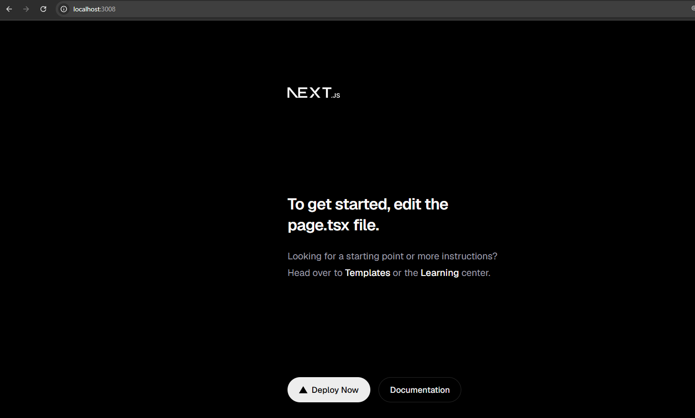

Then, go back to the terminal with the opened Claude Code session (It should be at the `/starting-project` level), and type this prompt:

```
Replace the starting page of this Next.js project with a page that says "Hello World", centered in the middle of the screen
```

Now the starting screen becomes:

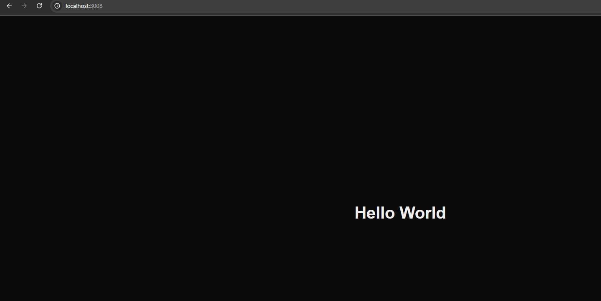

From the Claude Code session I see:

```bash
Updated app\page.tsx (+3 -61)

etc.

I replaced the starter page in app/page.tsx. It now shows only "Hello World", centered on the
  screen both horizontally and vertically:
● I replaced the starter page in app/page.tsx. It now shows only "Hello World", centered on the screen both horizontally and vertically:

  export default function Home() {
    return (
      <main className="flex min-h-screen items-center justify-center">
        <h1 className="text-4xl font-bold">Hello World</h1>
      </main>
    );
  }

  The centering uses Tailwind classes, which the project already has set up. min-h-screen makes the area fill the full screen height so the
  text sits in the middle. I haven't run the app to check it. Run bun dev (or npm run dev) and open http://localhost:3000 to see it.
```

#### Back to course

Today's progress:

```
Resume this session with:
claude --resume 0342b13b-37e1-4017-970e-18b5add6d358
```

I restarted the extension, `Claude Code for VS Code`, to make sure I will be able to see the code comparison from Claude Code sessions next time.

### A Glimpse At The Claude Desktop App

Just showing there are `chat` tab and `code` tab in the desktop app. There's also mobile app with the two tabs.

For the majority of this course, just use the Claude Code CLI.

### Configuring Claude Code

I can see `.claude` folder in `C:\Users\<my name>\.claude`.

In there, there is a `settings.json` for us to add global settings:

```json
{
  "enabledPlugins": {
    "frontend-design@claude-plugins-official": true
  },
  "extraKnownMarketplaces": {
    "claude-plugins-official": {
      "source": {
        "source": "github",
        "repo": "anthropics/claude-plugins-official"
      }
    },
    "claude-code-plugins": {
      "source": {
        "source": "github",
        "repo": "anthropics/claude-code"
      }
    }
  },
  "effortLevel": "high",
  "autoUpdatesChannel": "latest"
}
```

Or run `/config` in a Claude Code session.

In the `settings.json` I can do this:

```json
{
  "$schema": "https://json.schemastore.org/claude-code-settings.json",
  "enabledPlugins": {
    "frontend-design@claude-plugins-official": true
  },
  "extraKnownMarketplaces": {
    "claude-plugins-official": {
      "source": {
        "source": "github",
        "repo": "anthropics/claude-plugins-official"
      }
    },
    "claude-code-plugins": {
      "source": {
        "source": "github",
        "repo": "anthropics/claude-code"
      }
    }
  },
  "effortLevel": "high",
  "autoUpdatesChannel": "latest",
  "permissions": {  // here!
    "deny": [
      "Read(**/.env)",
      "Read(**/.env.*)",
      "Read(**/secrets/**)",
      "Read(**/config/credentials.json)",
      "Edit(**/.env)",
      "Edit(**/.env.*)",
      "Bash(curl *)"
    ]
  }
}
```

Reasons for each change:

- `**/` instead of `./`. `./` means the current folder only. `**/` matches the file in any subfolder too, like `backend/.env`. So `Read(./.env)` is already covered by `Read(**/.env)`, and you can remove it.
- Added `Read(**/.env.*)`. `**/.env` does not match `.env.local` or `.env.production`. You had `./.env.*` but only for the current folder.
- `Edit` instead of `Write`. In the official docs, the file rule types are `Read` and `Edit`, and `Edit` rules cover all the tools that change files.

I can also create a `.claude` folder in the project folder and add a blank `settings.json` file. This will overwrite the global claude setting in this laptop. I also add a `settings.local.json` which is a project specific settings file that will overwrite the global settings and the `settings.json` files.

`settings.local.json` is not a part of the git history:

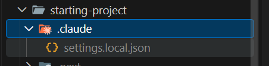

`settings.local.json` is used when each individual user wants to overwrite or extend parts of the project-specific or global settings.

In short:

- Global: System-wide configuration
- Project: Project-specific configuration
- Local: Project not committed

#### About adding these in the global settings of my laptop

In the `settings.json` I added these lines:

```json
"permissions": {
    "deny": [
      "Read(**/.env)",
      "Read(**/.env.*)",
      "Read(**/secrets/**)",
      "Read(**/config/credentials.json)",
      "Edit(**/.env)",
      "Edit(**/.env.*)",
      "Bash(curl *)"
    ],
    "defaultMode": "auto"
  }
```

To test if these work, I could try these cases:

```
Test each rule. Make a test folder with a fake .env, .env.local and secrets/key.txt. Then ask Claude:
“read .env.local” → should be blocked
“add a line to .env” → should be blocked
“run curl https://example.com” → should be blocked
“run cat .env” → this will likely work, which shows the Bash gap above
```

So I create these temporary folders:

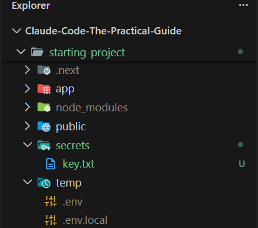

And try to tell Claude to `read .env.local` and yes, it's blocked, which is expected:

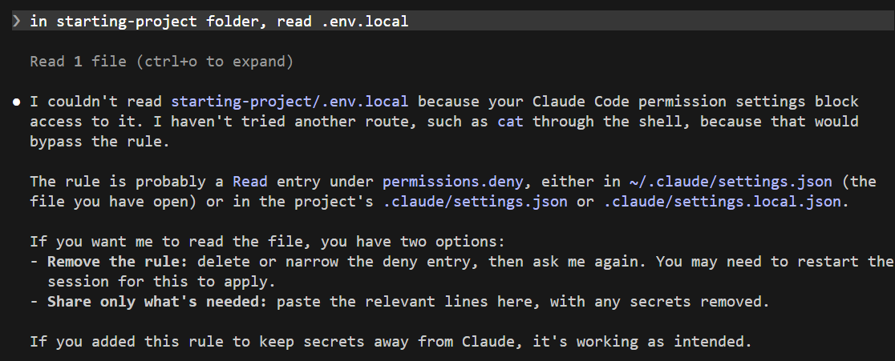

And no, Claude can't `add a line to .env`, which is expected:

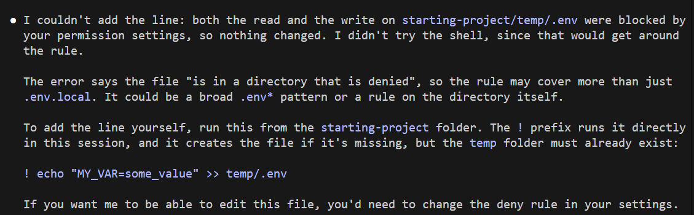

And no, Claude can't `run curl https://example.com`, which is expected:

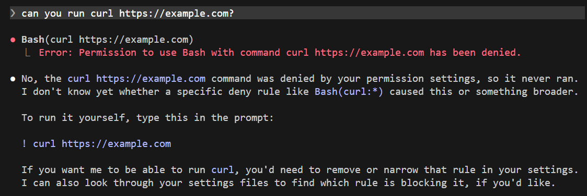

And no, Claude can't `cat .env`, which is good:

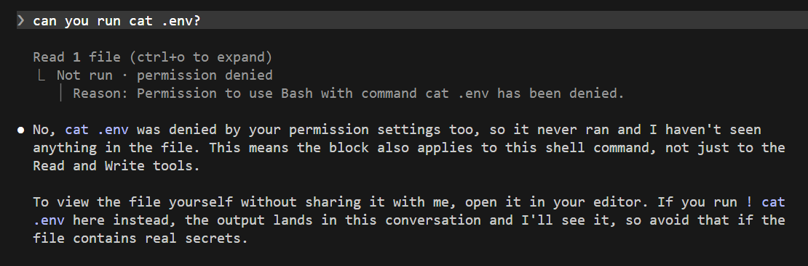

There are more settings I can use [here](https://code.claude.com/docs/en/settings-reference#available-settings).

### Choosing AI Models

One command you should be aware of right from the start is the `/model` command which let's you choose the AI model you want to use.

### Understanding Sessions & Context

Use `/clear` to start a new session by clearing the context window. Useful when I want to free up the context memory and start fresh, especially when AI is stuck or when I want to work on a new problem.

I can also just `/exit` and open a new terminal window and type `$claude` to start a new session in cc.

I can also have multiple Claude Code sessions run in parallel. I can work on the same project with multiple Claude Code sessions - just make sure the agents don't work against each other.

Another command - `/context` tells me how the context window for this session is currently being used or occupied:

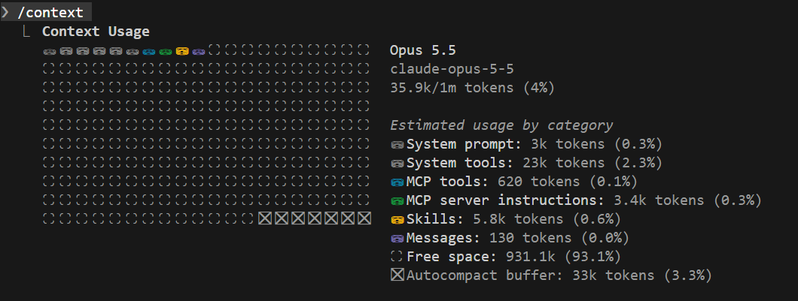

Another command - `/usage` tells me my usage per Claude Code plan:

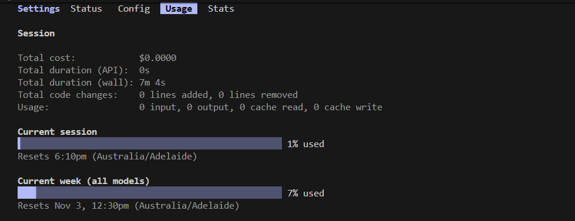

### When To Start New Sessions & Making Sense Of Compaction

In the last lecture, you learned about the context window and that it has a limited size.

But what happens if you run out of space (i.e., the conversation gets too long - which can easily happen since code files evaluated or code generated by Claude Code also take up valuable tokens)?

In this case, Claude Code will compact the conversation: It will generate a summary of the conversation, including some instructions (for itself) on how to proceed once the compaction process is over. So it won't stop working or anything like that - BUT some details from the conversation will get lost.

You can also trigger compaction manually via the /compact command (e.g., if you know that you're about to ask for a task that will require lots of free space in the context window).

Since compaction WILL lead to loss of information, it's typically a good idea to keep sessions concise and focused. When working on a new feature, you want to use a new session (by starting a new Claude Code instance in a new terminal window, or via the `/clear` command).

The same is true when getting stuck: If Claude Code can't fix a certain bug or just won't implement a feature the way you want it to, it's often better to try again in a new session, with a cleared context window.

###  Core Features You May Not Know Yet

Start from here:

```
claude --resume 88424d37-8bd3-476f-8496-bf27f8a5945a
```

#### To explore the code

I can just do this:

```bash
$ claude "explain this project"
```

And it will start a Claude Code session with that prompt:

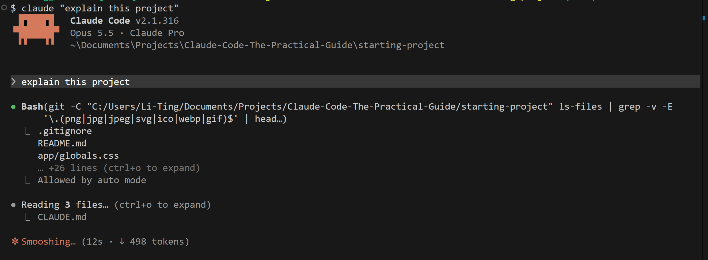

Here's the project overview:

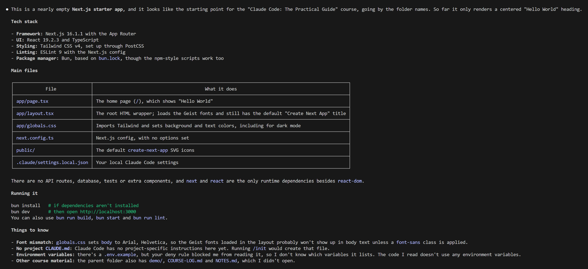

So Claude Code can do more than editing code.

I can also add this `-p` flag to let it run in the background:

```bash
$claude -p "explain this project"
```

And it will give me response directly in the terminal as well:

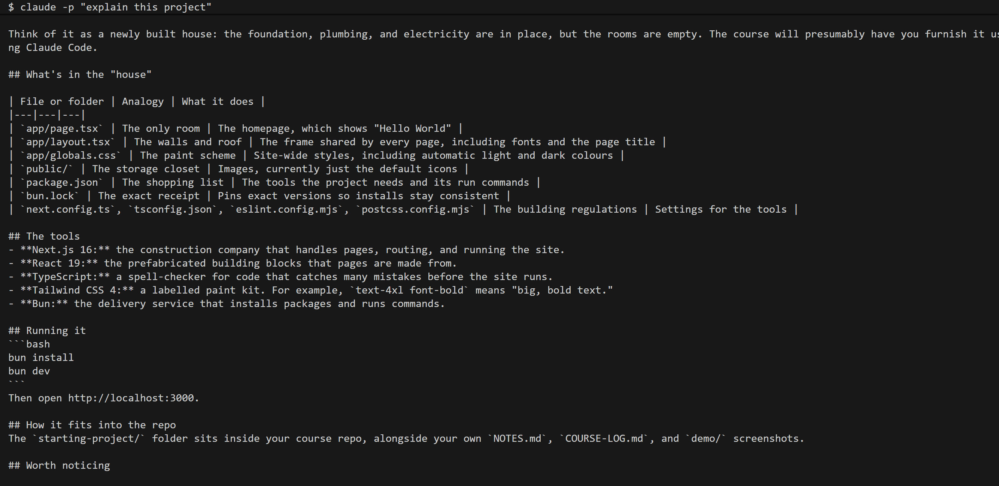

#### To go back to an older session

I can use `/resume` and  I can choose a previous session from the list:

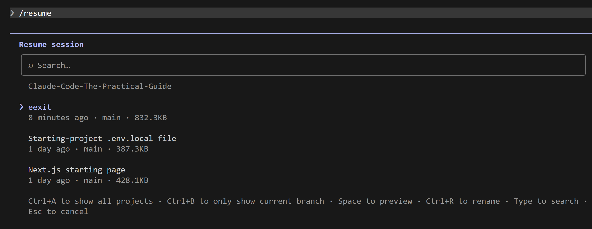

Or use this `-c` flag to let it start with the last session I worked on:

```bash
$claude -c
```

Which is the last project explanation session.

### Advanced Permissions Management

Use `shift + tab` to switch to `accept edits on` or `manual edits on`.

For example, prompt CC:

```
Add a list (bullet points) with advantages of Claude Code to the starting page
```

This is the manual mode where it will keep asking for permissions:

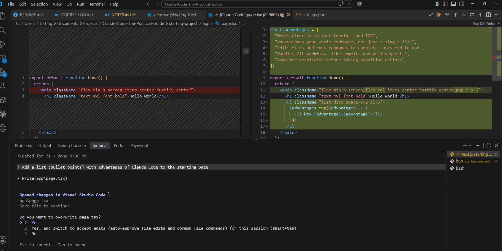

Now the list is shown on the starting page:

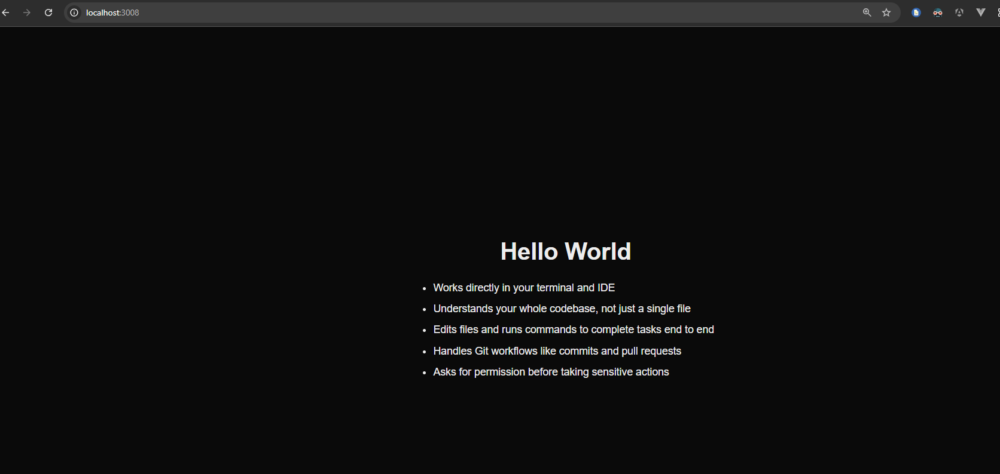

Then, try prompting CC:

```
create a new git commit
```

And I then switch to `auto mode on` so it won't keep asking for my permissions (if using `accept edits on` then anything OTHER THAN editing a code file will still ask me). 

Also, I said only commit the changes of the changed starting page:

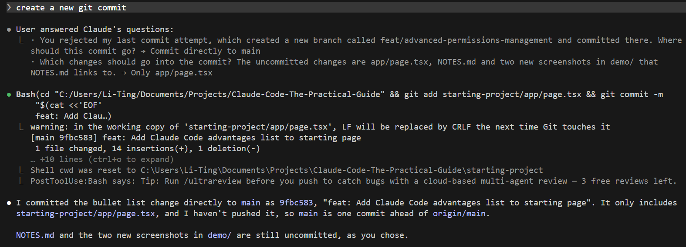

### Running Claude Code via Docker Sandboxes

If I want Claude Code to run on itself without worrying about it messing up my local machine, then I can consider running it in a docker env.

For example, do this to run up a docker sandbox to run Claude Code on my project:

```bash
$docker sandbox run claude
```

Quickly check - yeah I do have docker installed:

```bash
$ docker -v
Docker version 29.2.0, build 0b9d198
```

Then, run this command:

```bash
$ docker sandbox run claude
Starting sandboxd daemon...
Daemon started (PID: 12844, socket: \\.\pipe\docker_sandboxes_sandboxd)
Logs: C:\Users\Li-Ting\.docker\sandboxes\daemon.log
Creating new sandbox 'claude-starting-project'...
claude-code: Pulling from docker/sandbox-templates
b26dfee8a76a: Downloading [=============================================>     ]  120.6MB/132.2MB
435bf5c20694: Pull complete 
d9d511d19a19: Pull complete 
10635614e382: Pull complete 
b0c095d3a796: Pull complete 
372924dae370: Pull complete 
fcb35e50b26e: Pull complete 
cc3748c342ac: Pull complete 
df8785da9ae0: Pull complete 
0a300ff8534d: Pull complete 
288ba8dd0056: Pull complete 
1094b96aabd5: Pull complete 
2429833e0590: Downloading [================>                                  ]  122.7MB/361.7MB
4768dec80891: Pull complete 
a54c5bc1b691: Pull complete 
44136fa355b3: Download complete 
d7163075ad37: Download complete 
bc1cc6582f3b: Download complete
``` 

I will try it again tomorrow when I'm with better WIFI.

I gave up haha.

### Using Claude Code's Native Sandboxing

Other than using docker sandbox, CC also has native sandbox.

Every CC command is the same, just in this isolated environment.

Oh no I can't use it in my windows laptop:

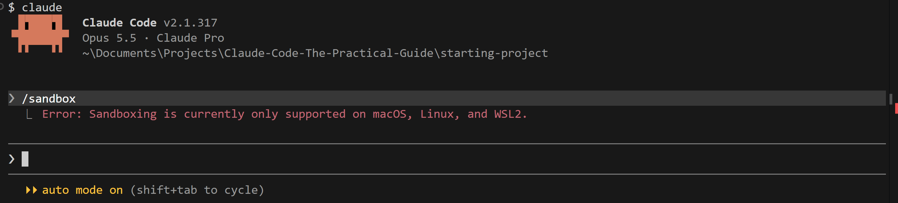

This concept is basically making sure CC only access the code in this project and make sure CC doesn't work outside of the current network access.

### Undoing Actions & The Importance of Version Control Systems

Try this prompt and I might not like it:

```bash
> Output an increment counter on the home page
```

It gives a code change like this:

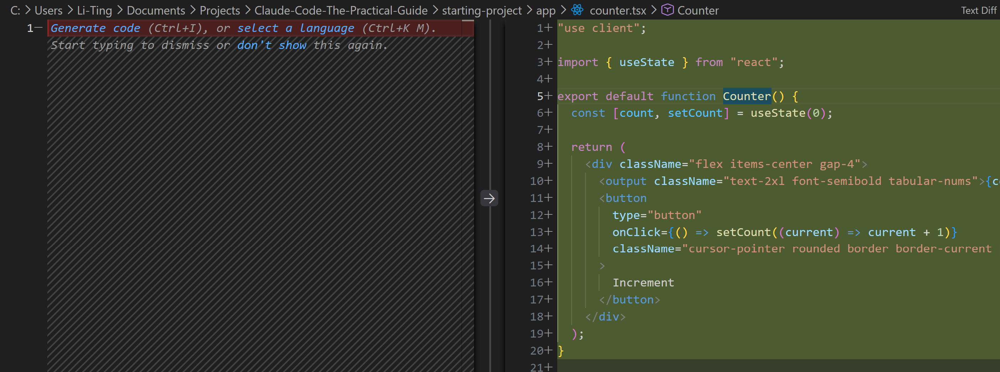

I can either have regular commits so I can easily reset back to the previous version of my code, or I can undo changes through CC like hitting `esc` key twice and I can go back to a snapshot i.e. a point of time:

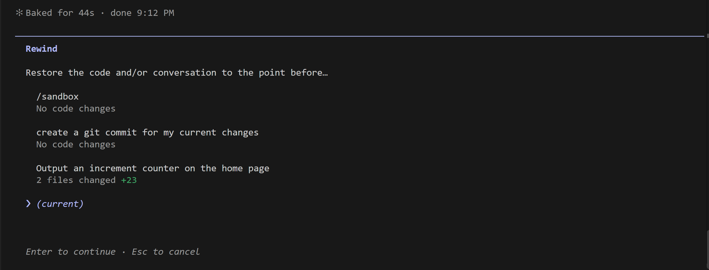

I chose to go back to the prompt, and then it prompts me to decide what to restore - I chose restore code and convo.

So all clear now:

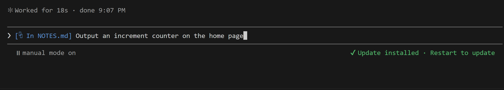

Another way is to use the `/rewind` command which will list out the session I want to rewind back.

Always double check though - Git version control is usually more reliable.

## Section 2: Key Features & Efficient Usage

### Module Introduction

Using Claude Code:
```
Prompt & Context Engineering
Plan Mode
Memory Management & CLAUDE.MD
Using Custom Subagents
Working with Agent Skills
```

### Making Sense of Prompt & Context Engineering

Good input = good results

Prompt & Context Engineering is about this:

```
Specific instruction(s) + Relevant context / extra information
```

### Prompt Engineering In Action & Working with Specs

I'm building a note taking app:
- user can create notes using a rich text editor.
- user can view, edit and delete their notes.
- an additional feature: allow users to share their notes, so they can view notes that don't belong to them.

What is that "prompt" when we build an app from scratch?

It can be a "specification doc" that describe the app.

The tutorial created the spec doc with the help of other AI model e.g. ChatGPT by describing the app to it first.

I used the tutorial's `SPEC.md` and saved it to the root of the project.

After that, I open a CC session to ask it to improve the `SPEC.md`.

In this prompt:
- `@` is the official way of including a specfic file into the prompt.
- `Better Auth` library doc is [here](https://better-auth.com/docs/concepts/database#core-schema). For example, the `user` table needs a certain schema shape. I can copy that doc page as a markdown.

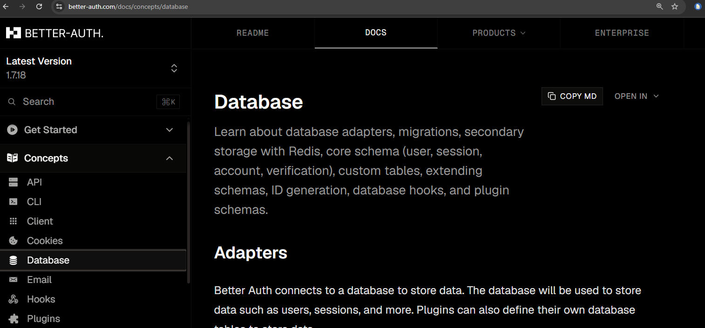

- `<better-auth-database-docs></better-auth-database-docs>`: the tutorial likes to use the xml tags when inserting a longer text or error message, but it helps the LLM know where a specific content starts and ends.

- Run this prompt in `accept edits on` mode to allow CC to auto edit the file. Press `Shift + Enter` to have multi-line inputs in the CC session:

```bash
We're building an app described in @..\SPEC.MD

Please format this file as proper markdown.

Also update the file and update the part about the "users" table and auth-related tables.
We're using the better-auth library which expects a certain database structure.

Here's the official better-auth database documentation article:
<better-auth-database-docs>
[Pasted text #2 +1059 lines]
</better-auth-database-docs>
```

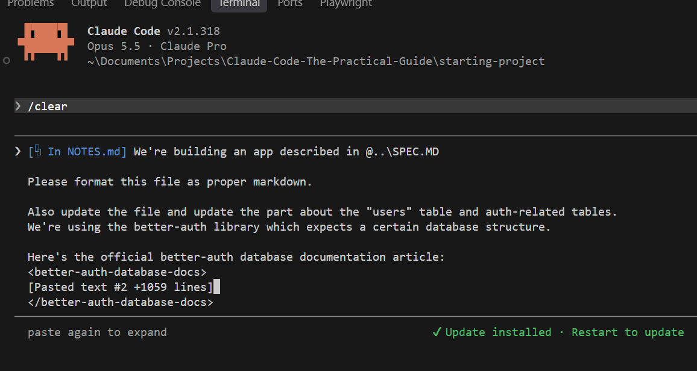

After it's done:

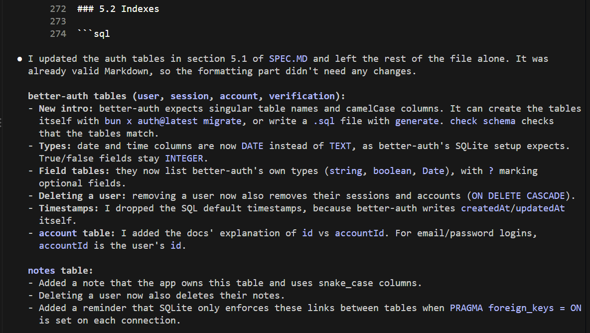

### Prompt & Context Engineering Recommendation

As explained, writing good prompts and providing helpful context is essential for achieving good results.

Therefore, here are some recommendations / best practices you should consider.

#### Concise & Precise

Keep your prompts concise and focused. Don't overdo, you should, of course, accurately and clearly describe the task you want the AI to tackle. But absolutely avoid including details that don't matter or unnecessary fluff.

#### No Unnecessary Context

Providing useful (!) context is crucial. But providing context that actually doesn't matter can be counterproductive.

For example, avoid referencing (@some-file) a file you THINK may matter. Focus on pointing at files you KNOW matter.

The same is, of course, true for documentation articles or any other kind of information that's not really relevant => Avoid it!

#### Think, Plan, Prompt

When working with AI, you may be tempted to just start typing and then "fix stuff over time". Don't do that!

Think first, then make a plan, then write a good prompt. If you find yourself asking for follow-ups or providing clarifications a lot, consider putting more effort into upfront planning. Even when using "Plan" mode (which you should use for all tasks that aren't super trivial).

#### Don't "Test" The AI

If you know that a task will need the AI to overcome a certain challenge, or if you know about particularly challenging part involved by a task, DON'T hide that information from the AI.

Sure, it can be a nice feeling to see the AI struggle and fail, but if you want to get the job done, share all crucial information with the AI agent.

So, for example, if you know about a particular pitfall or common mistake, include it (AND a recommended solution) in your initial prompt.

#### Explicitly Tell The AI About Tools It Should Use

AI agents like Claude Code can use many tools - some built-in (like the "bash" tool, web requests etc.) and some provided via MCP servers (covered later in the course). There also are features like "subagents" or "skills" you can leverage (also covered later).

If you know that a certain tool or feature should be used for a (part of a) task - explicitly tell the AI to do so. Don't hope it automatically uses the right tool or feature just because it theoretically could.

There's one main theme across pretty much all recommendations: YOU are in control. YOU steer the AI.

### Initializing Claude Projects

I could manually install some packages like:
- `zod`: helps with validating user input
- `Tiptap` rich text editor: refer to the doc [here](https://tiptap.dev/docs/editor/getting-started/install/react#install-tiptap-dependencies) to append this `@tiptap/react @tiptap/pm @tiptap/starter-kit` part

```bash
$bun add better-auth zod @tiptap/react @tiptap/pm @tiptap/starter-kit
```

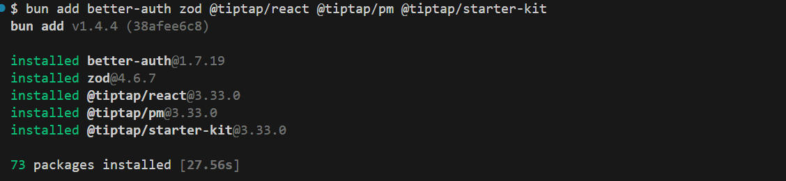

The good thing to do this manually is that sometimes CC can just update the `package.json` file with some older dependencies.

Another package I need to install but only to the `devDependencies` is this (it helps avoiding certain typescript errors related to bun APIs):

```bash
$bun add -D @types/bun
```

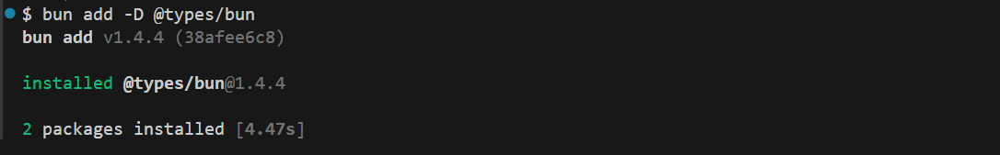

Now, start a new CC session.

Run the `/init` if I haven't used CC with this new project to create the `CLAUDE.md` file.

### Crafting Great CLAUDE.MD Files

There should be at least one CLAUDE.md file at the root project folder.

This file will be loaded automatically into any new session I create in CC.

And I need to make sure `bun` runtime gets used for this commands in `package.json`:

```json
// old
"scripts": {
  "dev": "next dev",
  "build": "next build",
  "start": "next start",
  "lint": "eslint"
}

// new
"scripts": {
  "dev": "bun run --bun next dev",
  "build": "bun run --bun next build",
  "start": "bun run --bun next start",
  "lint": "eslint"
},
```

Make sure my `CLAUDE.md` is brief and relevant!

I can update the content of it to be shorter after it's generated, and can also add extra rules manually.

I could have multiple `CLAUD.md` files in my project and I can put them into a subfolder. Just note that those nested `CLAUDE.md` files will only be read and loaded by CC when CC is working in that subfolder.

For example, if I created a `CLAUDE.md` file in the `app` folder, then it only gets read when CC is working a file inside the `app` folder.

The main purpose of `CLAUDE.md` at the root project folder is to store some long-term memory that should be accessible across different CC sessions and those core instructions that will apply to essentially every prompt.

### CLAUDE.md vs Auto Memory

Claude Code has two ways to keep instructions and information across sessions.

#### 1. CLAUDE.md (you manage it)

- You write it yourself.
- It holds key info and rules for every session.
- Keep it short and focused. Extra content wastes context space and can make results worse.

#### 2. Auto Memory (Claude manages it)

- Added in version 2.1.59.
- Claude Code saves what it learns by itself, for example a mistake you corrected many times or a code style you prefer.
- Stored in `~/.claude/projects/<project>/memory/MEMORY.md`, plus optional topic files in the same folder.
- The first 200 lines of `MEMORY.md` load in each new conversation.
- Claude is set up to keep these files short, for the same reason as CLAUDE.md.
- Use `/memory` to turn it on or off, set it up, and view or edit the files.

#### Key point

Auto Memory adds to CLAUDE.md. It does not replace it. If you already know a rule you want followed every time, put it in CLAUDE.md yourself. Don't rely on Claude to remember it.

### Leveraging Plan Mode

Focus on smaller tasks first.

Can run multiple CC instances in parallel i.e. one CC session each per terminal.

Start with the below prompt and use `plan mode`:

```bash
Let's start building the application described in @SPEC.MD .

Start by setting up the core route structure. Only add a dummy message to each page. No actual page content yet.

Just create all those different page.tsx files for the different application routes. Don't implement authentication yet.
```

Even if the task seems simple, it's better to start with the plan mode. It's the only mode that CC will gather info and ask you for clarification question, turning good prompts into amazing prompts.

```bash
❯ Let's start building the application described in @SPEC.MD .                                                                    
                                                                                                                                  
  Start by setting up the core route structure. Only add a dummy message to each page. No actual page content yet.                
                                                                                                                                  
  Just create all those different page.tsx files for the different application routes. Don't implement authentication yet.        
  ⎿  Read SPEC.MD (581 lines)

  Searched for 1 pattern, read 1 file (ctrl+o to expand)

● Updated plan
  ⎿  /plan to preview

──────────────────────────────────────────────────────────────────────────────────────────────────────────────────────────────────
 Ready to code?

 Here is Claude's plan:
╌╌╌╌╌╌╌╌╌╌╌╌╌╌╌╌╌╌╌╌╌╌╌╌╌╌╌╌╌╌╌╌╌╌╌╌╌╌╌╌╌╌╌╌╌╌╌╌╌╌╌╌╌╌╌╌╌╌╌╌╌╌╌╌╌╌╌╌╌╌╌╌╌╌╌╌╌╌╌╌╌╌╌╌╌╌╌╌╌╌╌╌╌╌╌╌╌╌╌╌╌╌╌╌╌╌╌╌╌╌╌╌╌╌╌╌╌╌╌╌╌╌╌╌╌╌╌╌╌╌
 Plan: Core route scaffold

 Context

 Start building the SPEC.MD app by creating the route structure (SPEC §8.1–8.2). Placeholder pages only — no content, no auth, no
 layout changes.

 Files

 Each page is a server component returning <main className="p-6"><h1>…</h1></main> with a dummy message.

 ┌─────────────┬──────────────────────────────────────────────┬──────────────────────────────────────────────────────┐
 │    Route    │                     File                     │                        Notes                         │
 ├─────────────┼──────────────────────────────────────────────┼──────────────────────────────────────────────────────┤
 │ /           │ app/page.tsx (replace existing demo content) │ "Landing page"                                       │
 ├─────────────┼──────────────────────────────────────────────┼──────────────────────────────────────────────────────┤
 │ /login      │ app/(auth)/login/page.tsx                    │ "Login page"                                         │
 ├─────────────┼──────────────────────────────────────────────┼──────────────────────────────────────────────────────┤
 │ /register   │ app/(auth)/register/page.tsx                 │ "Register page"                                      │
 ├─────────────┼──────────────────────────────────────────────┼──────────────────────────────────────────────────────┤
 │ /dashboard  │ app/dashboard/page.tsx                       │ "Dashboard"                                          │
 ├─────────────┼──────────────────────────────────────────────┼──────────────────────────────────────────────────────┤
 │ /notes/[id] │ app/notes/[id]/page.tsx                      │ async; params: Promise<{ id: string }>, shows id     │
 ├─────────────┼──────────────────────────────────────────────┼──────────────────────────────────────────────────────┤
 │ /p/[slug]   │ app/p/[slug]/page.tsx                        │ async; params: Promise<{ slug: string }>, shows slug │
 └─────────────┴──────────────────────────────────────────────┴──────────────────────────────────────────────────────┘

 Not in scope: API routes, components, layout.tsx header, auth.

 Verification

 - bun x tsc --noEmit and bun run lint pass
 - bun run dev, visit each route and confirm dummy message renders
```

It also saves its plans locally temporarily:

```bash
ctrl+g to edit in Notepad · ~\.claude\plans\pasted-content-id-afdd-let-s-start-dreamy-tarjan.md
```

So it will be able to refer back even if the context window is cleared or closed.

Then follow up prompt:

```bash
I only want a single "/authenticate" route which supports only email + password auth
```

As the current plan has both `/login` and `/register` routes.

So I can tell CC to update its plan:

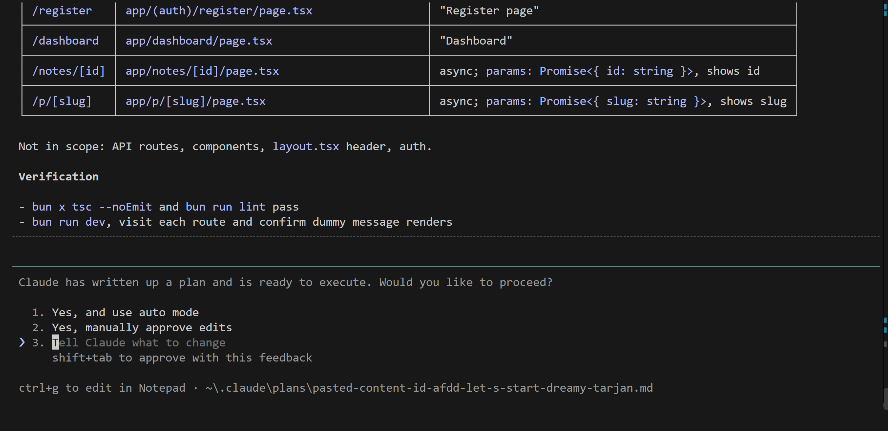

Once happy with the updated plan:

```bash
 User approved Claude's plan
⎿  Plan saved to: ~\.claude\plans\pasted-content-id-afdd-let-s-start-dreamy-tarjan.md · /plan to edit
Plan: Core route scaffold

Context

Start building the SPEC.MD app by creating the route structure (SPEC §8.1–8.2). Placeholder pages only — no content, no auth,
no layout changes.

Files

Each page is a server component returning <main className="p-6"><h1>…</h1></main> with a dummy message.

  ┌───────────────┬─────────────────────────────────────┬─────────────────────────────────────────────────────────────────────┐
  │     Route     │                File                 │                                Notes                                │
  ├───────────────┼─────────────────────────────────────┼─────────────────────────────────────────────────────────────────────┤
  │ /             │ app/page.tsx (replace existing demo │ "Landing page"                                                      │
  │               │  content)                           │                                                                     │
  ├───────────────┼─────────────────────────────────────┼─────────────────────────────────────────────────────────────────────┤
  │ /authenticate │ app/authenticate/page.tsx           │ "Authenticate (email + password sign in / sign up)" — single auth   │
  │               │                                     │ route, replaces SPEC's separate login/register                      │
  ├───────────────┼─────────────────────────────────────┼─────────────────────────────────────────────────────────────────────┤
  │ /dashboard    │ app/dashboard/page.tsx              │ "Dashboard"                                                         │
  ├───────────────┼─────────────────────────────────────┼─────────────────────────────────────────────────────────────────────┤
  │ /notes/[id]   │ app/notes/[id]/page.tsx             │ async; params: Promise<{ id: string }>, shows id                    │
  ├───────────────┼─────────────────────────────────────┼─────────────────────────────────────────────────────────────────────┤
  │ /p/[slug]     │ app/p/[slug]/page.tsx               │ async; params: Promise<{ slug: string }>, shows slug                │
  └───────────────┴─────────────────────────────────────┴─────────────────────────────────────────────────────────────────────┘

Not in scope: API routes, components, layout.tsx header, auth.

Verification

- bun x tsc --noEmit and bun run lint pass
- bun run dev, visit each route and confirm dummy message renders
```

then I can let it code it up:

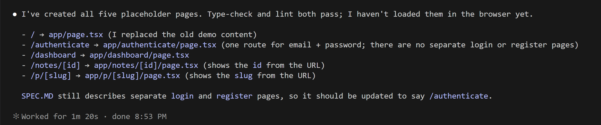

And run it up to check:

```bash
$ PORT=3008 bun run dev
```

For each route it looks like these:

route `/`:

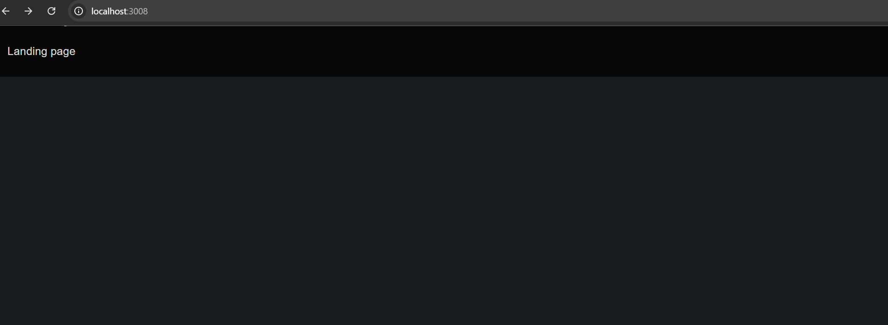

route `/authenticate`:

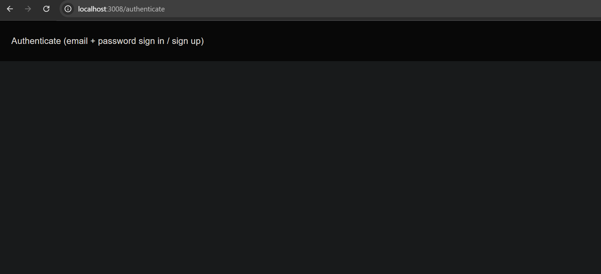

route `/dashboard`:

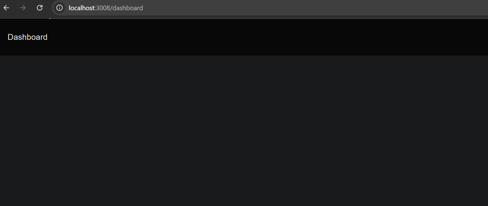

etc.

### Using Claude Code's Built-in Tools

Next use this prompt
- In CLAUDE.md, I already told CC to refer to @SPEC.MD so it should be able to pick it up

```bash
Implement authentication and database access.

Add a "lib" folder with "auth.ts" and "db.ts" files. Export a db handle in the db.ts file and make sure WAL mode is used and all required database tables are created if they don't exist yet.
```

But there will be extra details for Bun accessing a SQLite database and also extra details for Better Auth package.

I could ask CC to refer to a specific doc page by providing a link in the prompt.

For example tell CC to look at this:

```bash
Implement authentication and database access.

Add a "lib" folder with "auth.ts" and "db.ts" files. Export a db handle in the db.ts file and make sure WAL mode is used and all required database tables are created if they don't exist yet.

Visit the official docs websites:
- https://bun.com/docs/runtime/sqlite
```

Or just say:

```bash
Implement authentication and database access as described in @SPEC.MD .

Add a "lib" folder with "auth.ts" and "db.ts" files. Export a db handle in the db.ts file and make sure WAL mode is used and all required database tables are created if they don't exist yet.

Use web search to find the relevant documentation for Bun SQLite and better-auth setup (with next.js and Bun SQLite).
```

but all these prompts rely on my inputs like I need to explicitly feed CC some context.

Another way is to use an MCP.

### Using MCP Servers & More On Permissions

MCP is simply giving CC more tools for it to leverage.

https://code.claude.com/docs/en/mcp-quickstart

For example, context7, which gives CC the ability to access official docs of libraries.

https://github.com/upstash/context7

Run this command to install context7 to my Claude Code:

```bash
$ claude mcp add context7 -- npx -y @upstash/context7-mcp
```

It's not on the README of context7 github anymore. There is more detailed command on here:

https://context7.com/docs/resources/all-clients#claude-code

The simple command still works:

It just adds Context7 as a local server. The official Context7 docs now show two small changes, though:

- `--scope user`. This makes Context7 available in all my projects, not just the current folder. Without it, the default scope is “local”, so it only works in the folder where I ran the command.
- `--api-key`. The key is optional, but it gives me higher rate limits and access to private repos. I can get one free at `context7.com/dashboard`.

The current local version from the docs is:

```bash
claude mcp add --scope user context7 -- npx -y @upstash/context7-mcp --api-key YOUR_API_KEY
```

Anyways, I will just run the simple one.

Once I run the command it will print this:

```bash
$ claude mcp add context7 -- npx -y @upstash/context7-mcp
✔ Added stdio MCP server context7 with command: npx -y @upstash/context7-mcp to local config
File modified: C:\Users\Li-Ting\.claude.json [project: C:/Users/Li-Ting/Documents/Projects/Claude-Code-The-Practical-Guide]
```

Then start a new CC session and paste in this prompt in:
- This is particularly useful when I don't know or don't want to look up which doc to look at for a library.
- Switch to plan mode before running this prompt!

```bash
Implement authentication and database access as described in @SPEC.MD .

Add a "lib" folder with "auth.ts" and "db.ts" files. Export a db handle in the db.ts file and make sure WAL mode is used and all required database tables are created if they don't exist yet.

Use web search or the context7 mcp to find the relevant documentation for Bun SQLite and better-auth setup (with next.js and Bun SQLite).
```

Its plan:

```bash
 Ready to code?

 Here is Claude's plan:
╌╌╌╌╌╌╌╌╌╌╌╌╌╌╌╌╌╌╌╌╌╌╌╌╌╌╌╌╌╌╌╌╌╌╌╌╌╌╌╌╌╌╌╌╌╌╌╌╌╌╌╌╌╌╌╌╌╌╌╌╌╌╌╌╌╌╌╌╌╌╌╌╌╌╌╌╌╌╌╌╌╌╌╌╌╌╌╌╌╌╌╌╌╌╌╌╌╌╌╌╌╌╌╌╌╌╌╌╌╌╌╌╌╌╌╌╌╌╌╌╌╌╌╌╌╌╌╌╌╌╌╌
 Plan: Auth + DB layer (lib/db.ts, lib/auth.ts)

 Context

 SPEC.MD §5–§7 requires a Bun SQLite data layer and better-auth (email/password) wired into Next.js. Only the page scaffold exists;
 starting-project/lib/ is empty. Goal: a working DB handle (WAL, FKs, tables auto-created) and a better-auth server instance +
 Next route handler so later steps (notes repo, API routes, UI) can build on it.

 Docs confirmed via context7 (better-auth v1.7):
 - betterAuth({ database: new Database(path) }) accepts a bun:sqlite Database directly (built-in Kysely BunSqliteDialect).
 - Next: toNextJsHandler(auth) at app/api/auth/[...all]/route.ts; nextCookies() must be the last plugin; server session via
   auth.api.getSession({ headers: await headers() }).

 Files (all under starting-project/)

 1. lib/db.ts (new)

 - import { Database } from "bun:sqlite"; DB file at data/app.db (create data/ with mkdirSync(..., { recursive: true })).
 - Singleton cached on globalThis (avoids multiple connections under Next dev HMR).
 - On open: PRAGMA journal_mode = WAL;, PRAGMA foreign_keys = ON;, PRAGMA busy_timeout = 5000;.
 - Run schema once via db.exec(...) with CREATE TABLE IF NOT EXISTS for user, session, account, verification (exact SQL from SPEC
   §5.1, camelCase columns), notes, and CREATE INDEX IF NOT EXISTS for the 3 indexes in §5.2.
 - Exports: db (the handle, as requested), getDb(), and typed helpers query<T>(sql, params?), get<T>(sql, params?), run(sql,
   params?) per SPEC §6.1 (thin wrappers over db.query(sql).all/get/run).

 2. lib/auth.ts (new)

 - betterAuth({ database: db, emailAndPassword: { enabled: true, minPasswordLength: 8 }, plugins: [nextCookies()] }), importing db
   from ./db so auth and app share one connection with the same pragmas/schema.
 - Export auth plus server helpers getSession() and getCurrentUser() (wrap auth.api.getSession({ headers: await headers() })) for
   SSR/API 401 checks (SPEC §7.1).

 3. lib/auth-client.ts (new)

 - createAuthClient() from better-auth/react; export signIn, signUp, signOut, useSession for client components.

 4. app/api/auth/[...all]/route.ts (new)

 - export const { GET, POST } = toNextJsHandler(auth);

 5. Config

 - .env.local (gitignored already): BETTER_AUTH_SECRET=<random>, BETTER_AUTH_URL=http://localhost:3000.
 - .gitignore: add /data/ (SQLite file + -wal/-shm).
 - next.config.ts: only if the bundler fails to resolve bun:sqlite, add serverExternalPackages: ["bun:sqlite"] (or equivalent
   externals).

 Verification

 1. bun x tsc --noEmit and bun run lint pass.
 2. bun run dev; confirm data/app.db (+ -wal) is created.
 3. bun -e query PRAGMA journal_mode → wal; sqlite_master lists the 5 tables + indexes.
 4. bun x --bun auth@latest check schema (or startup log) reports no schema mismatch.
 5. Sign-up/sign-in smoke test: curl -X POST localhost:3000/api/auth/sign-up/email -H "content-type: application/json" -d
    '{"email":"a@b.com","password":"password123","name":"A"}' → 200 and a row in user/account; then GET /api/auth/get-session with
    the returned cookie returns the user.

    Approved Claude's plan
  ⎿  Plan saved to: ~\.claude\plans\pasted-content-id-b80b-implement-authen-shiny-crayon.md · /plan to edit
     Plan: Auth + DB layer (lib/db.ts, lib/auth.ts)

     Context

     SPEC.MD §5–§7 requires a Bun SQLite data layer and better-auth (email/password) wired into Next.js. Only the page scaffold
     exists; starting-project/lib/ is empty. Goal: a working DB handle (WAL, FKs, tables auto-created) and a better-auth server
     instance + Next route handler so later steps (notes repo, API routes, UI) can build on it.

     Docs confirmed via context7 (better-auth v1.7):
     - betterAuth({ database: new Database(path) }) accepts a bun:sqlite Database directly (built-in Kysely BunSqliteDialect).
     - Next: toNextJsHandler(auth) at app/api/auth/[...all]/route.ts; nextCookies() must be the last plugin; server session via
       auth.api.getSession({ headers: await headers() }).

     Files (all under starting-project/)

     1. lib/db.ts (new)

     - import { Database } from "bun:sqlite"; DB file at data/app.db (create data/ with mkdirSync(..., { recursive: true })).
     - Singleton cached on globalThis (avoids multiple connections under Next dev HMR).
     - On open: PRAGMA journal_mode = WAL;, PRAGMA foreign_keys = ON;, PRAGMA busy_timeout = 5000;.
     - Run schema once via db.exec(...) with CREATE TABLE IF NOT EXISTS for user, session, account, verification (exact SQL from
       SPEC §5.1, camelCase columns), notes, and CREATE INDEX IF NOT EXISTS for the 3 indexes in §5.2.
     - Exports: db (the handle, as requested), getDb(), and typed helpers query<T>(sql, params?), get<T>(sql, params?), run(sql,
       params?) per SPEC §6.1 (thin wrappers over db.query(sql).all/get/run).

     2. lib/auth.ts (new)

     - betterAuth({ database: db, emailAndPassword: { enabled: true, minPasswordLength: 8 }, plugins: [nextCookies()] }), importing
       db from ./db so auth and app share one connection with the same pragmas/schema.
     - Export auth plus server helpers getSession() and getCurrentUser() (wrap auth.api.getSession({ headers: await headers() }))
       for SSR/API 401 checks (SPEC §7.1).

     3. lib/auth-client.ts (new)

     - createAuthClient() from better-auth/react; export signIn, signUp, signOut, useSession for client components.

     4. app/api/auth/[...all]/route.ts (new)

     - export const { GET, POST } = toNextJsHandler(auth);

     5. Config

     - .env.local (gitignored already): BETTER_AUTH_SECRET=<random>, BETTER_AUTH_URL=http://localhost:3000.
     - .gitignore: add /data/ (SQLite file + -wal/-shm).
     - next.config.ts: only if the bundler fails to resolve bun:sqlite, add serverExternalPackages: ["bun:sqlite"] (or equivalent
       externals).

     Verification

     1. bun x tsc --noEmit and bun run lint pass.
     2. bun run dev; confirm data/app.db (+ -wal) is created.
     3. bun -e query PRAGMA journal_mode → wal; sqlite_master lists the 5 tables + indexes.
     4. bun x --bun auth@latest check schema (or startup log) reports no schema mismatch.
     5. Sign-up/sign-in smoke test: curl -X POST localhost:3000/api/auth/sign-up/email -H "content-type: application/json" -d
        '{"email":"a@b.com","password":"password123","name":"A"}' → 200 and a row in user/account; then GET /api/auth/get-session
       externals).

     Verification

     1. bun x tsc --noEmit and bun run lint pass.
     2. bun run dev; confirm data/app.db (+ -wal) is created.
     3. bun -e query PRAGMA journal_mode → wal; sqlite_master lists the 5 tables + indexes.
     4. bun x --bun auth@latest check schema (or startup log) reports no schema mismatch.
     5. Sign-up/sign-in smoke test: curl -X POST localhost:3000/api/auth/sign-up/email -H "content-type: application/json" -d
        '{"email":"a@b.com","password":"password123","name":"A"}' → 200 and a row in user/account; then GET /api/auth/get-session
        with the returned cookie returns the user.
...

The database layer and the better-auth setup are in place. Type-check and lint pass, and the database starts up correctly. I
  haven't run a sign-up through the dev server yet because the smoke test was blocked.

  What I added (in starting-project/):
  - lib/db.ts: exports db and getDb(), plus the query<T>, get<T> and run helpers from SPEC §6.1.
    - Opens data/app.db and turns on WAL mode and foreign keys.
    - Creates the 5 tables (user, session, account, verification, notes) and the 3 indexes only if they don't exist yet.
    - Reuses a single connection, so dev-server reloads don't open new ones.
  - lib/auth.ts: the better-auth setup, using the same db connection, with email/password sign-up (minimum 8 characters). It also
    exports getSession() and getCurrentUser() for server code.
  - lib/auth-client.ts: signIn, signUp, signOut and useSession for client components.
  - app/api/auth/[...all]/route.ts: the route that handles all better-auth requests.
  - .gitignore: now ignores /data/, where the database file lives.

  The better-auth setup follows its current docs (via context7), which say it can use a Bun SQLite database directly.

  Checks:
  - tsc --noEmit and bun run lint both pass.
  - Opening the database directly gave journal_mode=wal and foreign_keys=1, and all 5 tables and 3 indexes exist.
  - Not tested: creating an account and getting a session back through the running app. My attempt to put a secret into .env.local
    was blocked by the permission check, and so were the follow-up curl requests to the dev server.

  You need to:
  1. Create .env.local:
  BETTER_AUTH_SECRET=<run: bun -e "console.log(crypto.randomUUID()+crypto.randomUUID())">
  BETTER_AUTH_URL=http://localhost:3000
  2. Run bun run dev and send POST /api/auth/sign-up/email. If Next fails with "can't resolve bun:sqlite", add
     serverExternalPackages: ["bun:sqlite"] to next.config.ts.

✻ Baked for 2m 4s · done 9:22 PM

※ recap: We're setting up the database and login for the notes app, and the database code and login setup are written and pass 
  type-check and lint. Next, create `.env.local` with a `BETTER_AUTH_SECRET`, then run `bun run dev` and test sign-up. (turn off 
  recaps in /config)
```

#### 2026-11-20: Implement auth + DB layer (plan)

**Prompt:**
> Implement authentication and database access as described in `@SPEC.MD`.
> Add a `lib` folder with `auth.ts` and `db.ts` files. Export a db handle in `db.ts`,
> use WAL mode, and create all required tables if they don't exist yet.
> Use web search or the context7 MCP for Bun SQLite and better-auth docs.

**Plan (approved):**
- `lib/db.ts`: `bun:sqlite` at `data/app.db`, singleton on `globalThis` (avoids extra
  connections on dev reload). PRAGMAs: `journal_mode = WAL`, `foreign_keys = ON`,
  `busy_timeout = 5000`. Tables and indexes created with `IF NOT EXISTS` (SPEC §5.1, §5.2).
- `lib/auth.ts`: `betterAuth()` with the same `db`, email/password, `nextCookies()` last.
  Helpers `getSession()` and `getCurrentUser()` (SPEC §7.1).
- `lib/auth-client.ts`: `createAuthClient()` from `better-auth/react`.
- `app/api/auth/[...all]/route.ts`: `toNextJsHandler(auth)`.
- `.gitignore`: add `/data/`. Secrets go in `.env.local` (not committed).

**Verification status**
- [x] `bun x tsc --noEmit` passes (confirmed in later review)
- [ ] `bun run lint`
- [ ] `data/app.db` and `-wal` file created on dev start
- [ ] `PRAGMA journal_mode` returns `wal`
- [ ] `bun x --bun auth@latest check schema`
- [ ] Sign-up/sign-in smoke test with `curl` (test account only)

### Understanding Subagents

While that prompt is running, learn about how CC works and how to optimise it.

For example, use CC to check if my current implementation is in line with my expectations and the usage instructions by the libraries I'm using.

```bash
We're building @SPEC.MD .

Please evaluate the existing codebase to check whether authentication and database access are implemented correctly (in line with the expectations explained in SPEC.MD and the official documentation for the libraries / technologies used).

Use web search or the context7 mcp to look up docs.
```

Not in plan mode and not in edit mode.

The advantage of subagent is that they have their own context window so they don't pollute the context window of the main agent.

The summary of the subagent will be loaded into the main agent.

Output:

```bash
Authentication and database access are set up correctly so far and match SPEC.MD and the better-auth 1.7 docs. There are no bugs,
  but a few pieces aren't wired up yet. The type-check passes; I haven't run the app or the better-auth schema check.

  What's correct
  - lib/db.ts: bun:sqlite opens a single file at data/app.db and is created only once, even when Next reloads in dev. Every
    connection turns on foreign_keys = ON, which SPEC §5 requires. The schema matches SPEC §5.1 exactly, including the four
    better-auth tables with camelCase columns, the notes table and its indexes. getDb, query, get and run match §6.1.
  - better-auth uses the same database: the docs show passing a bun:sqlite Database straight in as database. I also checked the
    installed source: better-auth recognises Bun's driver and uses its built-in Bun SQLite support.
  - lib/auth.ts: email and password sign-in is on, and nextCookies() is the last plugin, as the docs require. getSession() and
    getCurrentUser() use auth.api.getSession({ headers: await headers() }), the documented way to read the session on the server
    (§7.1).
  - app/api/auth/[...all]/route.ts: toNextJsHandler(auth) is the documented way to mount the auth routes.
  - lib/auth-client.ts: createAuthClient() with no baseURL is fine because the app and the auth routes are on the same site.
  - The --bun flag in the scripts is required for bun:sqlite to load, and it's there.

  Gaps and risks
  1. No secret configured: there's no .env or .env.local, so BETTER_AUTH_SECRET isn't set. better-auth falls back to a default
     secret in dev, which is insecure, and refuses to start in production. Set it, along with BETTER_AUTH_URL (the docs recommend
     both). I couldn't check .env.example because your permission settings block reading it.
  2. Pages aren't protected yet: /dashboard is a stub and doesn't check the session. SPEC §11 requires a server-side check on
     /dashboard and /notes/[id]. Use the documented pattern: call getSession(), then redirect() if there's no session. You can also
     add a Next 16 proxy.ts (the new name for middleware) as a first check, but keep the check on the page itself.
  3. Not built yet: lib/notes.ts, /api/notes/* and the login/register UI don't exist. Every query in notes.ts needs to filter by
     user_id = ?.
  4. Tables are created on startup: db.ts creates the auth tables itself instead of using bun x --bun auth@latest migrate. That's
     allowed under SPEC §5.1. Running bun x --bun auth@latest check schema once would confirm the tables match what better-auth
     expects.
  5. Optional: add import "server-only" to lib/db.ts and lib/auth.ts so they can't be pulled into browser code by accident.
     minPasswordLength: 8 is already better-auth's default, so that line can go.

  Sources: better-auth v1.7 docs (adapters/sqlite.mdx, integrations/next.mdx) and the installed @better-auth/kysely-adapter source.

✻ Cooked for 1m 15s · done 9:29 PM

※ recap: I was reviewing your notes app's login and database setup against SPEC.MD and the better-auth docs; both are set up 
  correctly, with no bugs found. Next step: set BETTER_AUTH_SECRET in a .env file, then add session checks to the dashboard and note
  pages. (turn off recaps in /config)
```

#### How do I know if subagents are used?

In Claude Code, the main agent’s actions show as plain tool calls at the top level:

```bash
● Bash(...) runs a shell command
Read 10 files reads files
Called context7 3 times calls an MCP tool
● Updated plan updates a plan
```

A sub agent shows up differently. The main agent starts it with an Agent call (older versions call it Task). It usually looks something like this:
```bash
● Explore(Find auth setup files)
  ⎿  Done (12 tool uses · 30k tokens · 45s)
```

The key signs are:

- The name is an agent type, such as Explore, Plan or general-purpose, not a tool like Bash or Read.
- There’s a short task description in the brackets, written in plain English, not a command.
- There’s a summary line with a tool use count, token count and time. The sub agent’s own steps are hidden inside it, not listed one by one.

Your review output has none of these. Each line is a Bash, Read or context7 call, so the main agent did all the work itself.

#### Does it matter?

A subagent works in its own separate context. It does a job and sends back only the result. Each subagent uses its own context window separate from the main conversation. 

This helps in a few cases:

- Big codebase searches. The main chat stays clean, so answers stay sharp in long sessions.
- Parallel work. Several subagents can search or review at the same time.
- Focused jobs. For example, a code reviewer that can only read files and cannot change them.

For small tasks, the main agent is often better. It is faster, it uses fewer tokens, and it keeps all the context in one place. So if your task is small, getting only the main agent is not a problem.

#### How to get subagents on purpose

- Just ask. The most flexible approach is simply asking Claude to use subagents in conversation. For example: “Use subagents to explore the auth and payment folders in parallel.” 
- Name one. To make sure a specific subagent is used, mention it by name in your prompt. This bypasses automatic matching. For example: “Use the Explore agent to find all API routes.”
- Create your own. Run /agents to see and create subagents for your project.

### Creating & Using A Custom Subagent

Under the `.claude` folder I need to have a folder named `agents`.

Inside that folder, add a markdown like `DocsExplorer.md`, so that CC can use it for this project. It can also be added globally by finding the root `.claude` folder under my username of this laptop and find/create a folder called `agent`. Then, add `DocsExplorer.md` there.

`DocsExplorer.md` is referred from here:

https://github.com/academind/claude-code-course-resources/blob/main/other/subagent/DocsExplorer.md

For example:

```markdown
---
name: DocsExplorer
description: Documentation lookup specialist. Use proactively when needing docs for any library, framework, or technology. Fetches docs in parallel for multiple technologies.
tools: WebFetch, WebSearch, Skill, MCPSearch
model: sonnet
---
etc.
```
The `name` is the name of the sub agent.

The `tools` can be added from this reference:

https://code.claude.com/docs/en/tools-reference

Especially `MCPSearch` allows CC to dynamically load MCP tools.

As it's just for exploring docs, so the `model` can just be `sonnet`.

Then describe in the `## Workflow` section in the markdown file to tell CC how that sub-agent should work.

In the `## Lookup Strategy` section, `/llms.txt` is to tell CC to find the LLM-friendly pages for reference instead as many websites these days have that sort of format for their documentations.

So now my prompt can just be as below i.e. can remove `Use web search or the context7 mcp to look up docs.` this line from the prompt:

```bash
We're building @SPEC.MD .

Please evaluate the existing codebase to check whether authentication and database access are implemented correctly (in line with the expectations explained in SPEC.MD and the official documentation for the libraries / technologies used).
```

### Encouraging Agent Usage

To encourage CC to use `DocsExplorer.md` this sub agent, in the `CLAUDE.md` I can add this:

```markdown
Whenever working with any third-party library or something similar, you MUST look up the official documentation to ensure that you're working with up-to-date information.

Use the DocsExplorer subagent for efficient documentation lookup.
```

Into here:

```markdown
# CLAUDE.md

We're building the app described in @SPEC.MD. Read that file for general architectural tasks or to double-check the exact database structure, tech stack or application architecture.

Keep your replies extremely concise and focus on conveying the key information. No unnecessary fluff, no long code snippets.

Whenever working with any third-party library or something similar, you MUST look up the official documentation to ensure that you're working with up-to-date information.

Use the DocsExplorer subagent for efficient documentation lookup.

This file provides guidance to Claude Code (claude.ai/code) when working with code in this repository.
```

So now I can send out a prompt like this:

```bash
We're building @SPEC.MD .

Please evaluate the existing codebase to check whether authentication and database access are implemented correctly (in line with the expectations explained in SPEC.MD and the official documentation for the libraries / technologies used).
```

Note that my CC session needs to be run under the `starting-project/` as Claude Code loads project subagents from `.claude/agents/` in the current project.

Now I can see the `DocsExplorer` subagent in the session log:

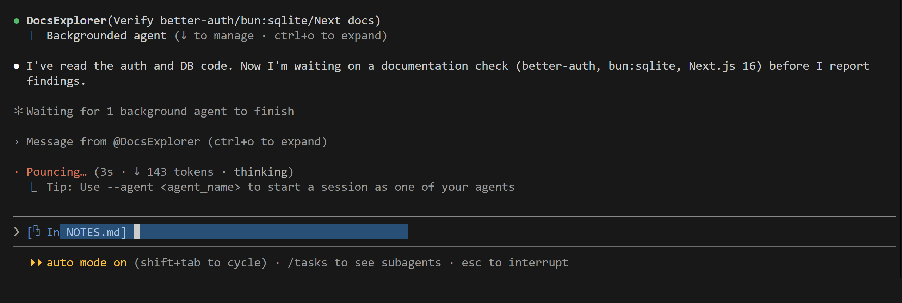

Here's the output:

```bash
● I've read the auth and DB code. Now I'm waiting on a documentation check (better-auth, bun:sqlite, Next.js 16) before I report
  findings.

✻ Waiting for 1 background agent to finish

› Message from @DocsExplorer (ctrl+o to expand)

● The auth and database code that exists is correct and matches SPEC.MD and the current docs (better-auth, bun:sqlite, Next.js 16).
  What's missing is route protection: the protected pages and the notes layer haven't been built yet.

  Implemented correctly
  - lib/db.ts
    - It opens one shared bun:sqlite connection and keeps it on globalThis, so dev reloads don't open new ones.
    - It turns on WAL mode, foreign keys and a busy timeout. WAL is what the Bun docs recommend.
    - The schema and indexes match SPEC §5 exactly, with camelCase columns for the better-auth tables.
    - get() turns Bun's null into undefined, which is right because Bun returns null when no row matches.
  - lib/auth.ts
    - The better-auth docs list passing a bun:sqlite Database directly as a supported pattern.
    - nextCookies() is the last plugin, as the docs require.
    - getSession() and getCurrentUser() use auth.api.getSession({ headers: await headers() }), the documented call.
  - app/api/auth/[...all]/route.ts is exactly the documented route handler.
  - lib/auth-client.ts is fine without a baseURL because the client and server share an origin.
  - .gitignore excludes /data/ and .env*.

  Gaps
  1. No route protection. /dashboard and /notes/[id] don't check the session, and there's no proxy.ts. Next 16 renamed middleware.ts
     to proxy.ts, and SPEC §11 requires a server-side check. Recommended setup:
     - In proxy.ts, use getSessionCookie for a fast redirect when the cookie is missing. It only checks that the cookie exists.
     - In each protected page and API handler, call getSession() and redirect or return 401.
  2. Notes layer not built yet: lib/notes.ts, /api/notes/* and the share endpoint (nanoid isn't installed). The pages are
     placeholders.
  3. Sign-up needs name. better-auth requires it in signUp.email, but the spec only mentions email and password. The form must send
     one, for example the part of the email before the @.
  4. Env vars. I didn't check .env. BETTER_AUTH_SECRET is needed in production, and BETTER_AUTH_URL is recommended.

  Minor
  - minPasswordLength: 8 is already better-auth's default (8–128), so the line is redundant but harmless.
  - The better-auth tables are created by hand in db.ts. To confirm they match, run bunx --bun auth@latest check schema. The docs
    say the --bun flag is needed because of bun:sqlite.
  - db.query() keeps compiled statements in a cache of 20. That suits fixed SQL; use db.prepare() if you build SQL strings
    dynamically.
  - If you switch to named parameters, add strict: true so a missing or misspelled parameter throws instead of silently binding
    NULL.
  - Route names differ from the spec: /authenticate instead of (auth)/login and (auth)/register. That's fine if intended.

  The docs check didn't confirm two things: whether Next needs extra config (serverExternalPackages) to import bun:sqlite, and the
  exact option names for the password minimum.

  Next step: should I add the route protection (proxy.ts plus session checks in the pages)?

● Agent "Verify better-auth/bun:sqlite/Next docs" finished · 28s
```

I expanded the DocsExplorer subagent's task log then I can see this `Findings (Context7 was unavailable, so I used WebFetch on the official docs). `:

```bash
› Message from DocsExplorer
  Findings (Context7 was unavailable, so I used WebFetch on the official docs). Not checked: the better-auth env vars
  (BETTER_AUTH_SECRET/BETTER_AUTH_URL) and the exact `emailAndPassword` option name for minimum password length. Also not checked:
  Next.js `serverExternalPackages` for `bun:sqlite`, and whether `bunx auth@latest migrate` works with `bun:sqlite`.

  **1. better-auth + bun:sqlite: a direct instance works, with no Kysely dialect needed**
  Source: https://www.better-auth.com/docs/adapters/sqlite
  - The docs list "Bun built-in SQLite" as a supported pattern:
  ```ts
  import { Database } from "bun:sqlite";
  database: new Database("database.sqlite"),
  ```
  - For CLI commands, the docs say to use `bunx` with the `--bun` flag "to avoid type errors related to the `bun:sqlite` module".
  That means `bunx --bun auth@latest ...`.
  - SQLite is supported "under the hood via the Kysely adapter". better-sqlite3 is the recommended driver, and `node:sqlite` needs
  Node 22.5 or later.

  **2. Next.js integration**
  Source: https://www.better-auth.com/docs/integrations/next
  - Route handler at `app/api/auth/[...all]/route.ts`:
  ```ts
  import { auth } from "@/lib/auth";
  import { toNextJsHandler } from "better-auth/next-js";
  export const { GET, POST } = toNextJsHandler(auth);
  ```
  - `nextCookies()` is imported from `better-auth/next-js`. The docs say "make sure this is the last plugin in the array", as in
  `plugins: [nextCookies()]`. It lets server actions set cookies.
  - Server-side session check: `const session = await auth.api.getSession({ headers: await headers() })`, with `headers` from
  `next/headers`.
  - Client: `import { createAuthClient } from "better-auth/react"`. The page's example is `createAuthClient({ /* you can pass client
  configuration here */ })`, so `baseURL` is not required there. I did not check the client docs for same-origin behaviour.
  - Route protection in Next 16: "Next.js 16 replaces 'middleware' with 'proxy'". Use `proxy.ts` and export a `proxy` function.
  Because the proxy runs on Node, it can call `auth.api.getSession({ headers: await headers() })` and redirect to `/sign-in` when
  there's no session.
  - `getSessionCookie` from `better-auth/cookies` "only checks for the existence of a session cookie". It is a fast, optimistic
  redirect check and doesn't validate the session. Validate the session on the server in pages and actions.
  - Next.js adds that a proxy matcher doesn't cover Server Functions on excluded paths, so check auth inside each server function
  too (https://nextjs.org/docs/app/api-reference/file-conventions/proxy).

  **3. emailAndPassword**
  Source: https://www.better-auth.com/docs/authentication/email-password
  - The page says the password "should be at least 8 characters long and max 128 by default".
  - The option-name table didn't render, so the name isn't confirmed. From memory, it is `emailAndPassword.minPasswordLength` (and
  `maxPasswordLength`). Treat that as unverified.
  - `name` is required in `signUp.email`. The docs say "required, The name of the user", and the type is `name: string`. `image` and
  `callbackURL` are optional.

  **4. CLI**
  Source: https://www.better-auth.com/docs/concepts/cli
  - `migrate` is "available if you're using the built-in Kysely adapter". A raw SQLite `Database` goes through that adapter. The
  page doesn't mention `bun:sqlite`, but the SQLite page's `--bun` note implies it works.
  - `generate` writes an SQL file for Kysely that you can run yourself.
  - The docs say nothing about `CREATE TABLE IF NOT EXISTS` conflicts. Creating the tables manually is a workable approach if the
  schema matches what `generate` outputs. Run `generate` and compare the result to your tables.

  **5. bun:sqlite**
  Source: https://bun.sh/docs/api/sqlite
  - `db.query(sql)` caches the compiled statement, not the results. Parameters are bound fresh on each call.
  - The cache holds `Database.MAX_QUERY_CACHE_SIZE` entries (default 20), and SQL over 64 KB isn't cached.
  - For one-off dynamic SQL, use `db.prepare()`, which returns a fresh, uncached statement.
  - `.get()` returns `null` when no row matches (not `undefined`).
  - Bun creates the file if it doesn't exist. `{ create: true }` is effectively the default, and `{ create: false }` throws if the
  file is missing. `{ readonly: true, create: true }` throws a `TypeError`.
  - The docs recommend WAL for most apps: `db.run("PRAGMA journal_mode = WAL;")`. `PRAGMA synchronous = NORMAL` gives faster
  commits.
  - With `strict: true`, a missing or misspelled named parameter throws. Without it, the parameter silently binds `NULL`.
  - Named parameter keys can include the prefix (`$`, `:` or `@`) or omit it. If the object has both forms, the prefixed key wins.
  With `strict: true`, the unprefixed key wins.

  **6. Next.js 16**
  Source: https://nextjs.org/docs/app/api-reference/file-conventions/proxy
  - The `middleware` convention is "deprecated and has been renamed to `proxy`". Version history: "v16.0.0: Middleware is deprecated
  and renamed to Proxy. Proxy defaults to the Node.js runtime".
  - The `runtime` config option isn't available in proxy files, and setting it throws an error.
  - The codemod is `npx @next/codemod@canary middleware-to-proxy .`.
  - Without a `matcher`, proxy runs on every request, including static assets. Use a negative-lookahead matcher that excludes `api`,
  `_next/static`, `_next/image` and so on.
  - The proxy docs say nothing about `serverExternalPackages` or `bun:sqlite`. The better-auth docs only say to use `bunx --bun` for
  the CLI.
```

So I updated the tools line in the `DocExplorer` subagent like this:

```markdown
tools: WebFetch, WebSearch, Skill, MCPSearch, mcp__context7__resolve-library-id, mcp__context7__query-docs
```

#### About how I got `mcp__context7__resolve-library-id` and `mcp__context7__query-docs`

I checked with Claude, and learned that:

```markdown
The tools: line needs the full tool names, not the server name. In Claude Code, MCP tools are named like this:

mcp__<server name>__<tool name>
```

- Step 1: get the exact tool names. 

In `/mcp`, select `context7` and press Enter. It will list the two tools.

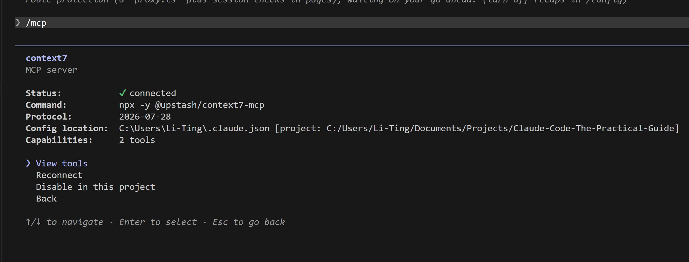

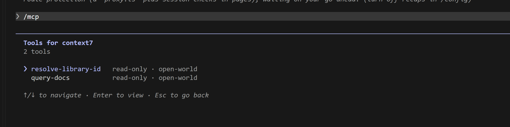

- Step 2: update the `tools` line with the exact tool names. 

For example:

```markdown
tools: WebFetch, WebSearch, mcp__context7__resolve-library-id, mcp__context7__query-docs
```

Now I can see my subagent connecting with context7:

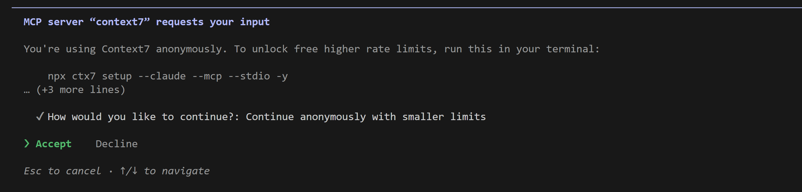

Back to the prompt and the Encouraging Agent Usage section.

So I prompt this again:

```bash
❯ We're building @SPEC.MD .                                                                                                         
                                                                                                                                    
  Please evaluate the existing codebase to check whether authentication and database access are implemented correctly (in line with 
  the expectations explained in SPEC.MD and the official documentation for the libraries / technologies used).       
```

Here's the new output:

```bash
❯ We're building @SPEC.MD .                                                                                                         
                                                                                                                                    
  Please evaluate the existing codebase to check whether authentication and database access are implemented correctly (in line with 
  the expectations explained in SPEC.MD and the official documentation for the libraries / technologies used).                      
  ⎿  Read SPEC.MD (580 lines)

● Bash(cd "C:/Users/Li-Ting/Documents/Projects/Claude-Code-The-Practical-Guide/starting-project" && find . -path ./node_modules
      -prune -o -path ./.next -prune -o -path…)
  ⎿  Blocked by auto mode · /permissions to review · see https://code.claude.com/docs/s/claude-code-auto-mode
     │ Auto mode: [Undermining Oversight]

  Searched for 2 patterns, read 10 files (ctrl+o to expand)

● DocsExplorer(Verify better-auth/Bun/Next docs)
  ⎿  Backgrounded agent (↓ to manage · ctrl+o to expand)

● I've reviewed lib/db.ts, lib/auth.ts, lib/auth-client.ts and the auth route. A DocsExplorer agent is now checking the code against
  the current better-auth, Bun SQLite and Next.js 16 docs. I'll report back once it finishes.

✻ Waiting for 1 background agent to finish

› Message from @DocsExplorer (ctrl+o to expand)
  
● The auth and database code is set up correctly and matches SPEC.MD and the current docs. The gaps are configuration and route
  protection, not mistakes in the code. I checked by reading the files and comparing them with the docs; I didn't runthe app.

  What's correct
  - lib/db.ts:
    - All five tables and the indexes match spec §5 exactly.
    - It turns on foreign_keys, WAL and busy_timeout, and reuses one connection across dev reloads.
    - getDb, query, get and run match §6.1, and get turns Bun's null into undefined.
    - /data/ is in .gitignore.
  - lib/auth.ts:
    - Passing the bun:sqlite Database straight to betterAuth is the documented way to do it.
    - nextCookies() is the last plugin, as the docs require.
    - getSession() and getCurrentUser() correctly await headers().
  - app/api/auth/[...all]/route.ts: uses toNextJsHandler(auth) exactly as the docs show.
  - lib/auth-client.ts: leaving out baseURL is fine because the app and the auth API are on the same origin.

  Issues
  1. No .env file or BETTER_AUTH_SECRET. In dev, better-auth quietly falls back to a built-in secret that everyone knows. In
     production it throws an error. Add BETTER_AUTH_SECRET (and BETTER_AUTH_URL for production).
  2. No route protection yet. There's no proxy.ts (Next 16's new name for middleware.ts), and dashboard/page.tsx and
     notes/[id]/page.tsx never check the session. Spec §11 requires a server-side check. Each page or route should call getSession()
     and redirect if there's no user. A proxy.ts that only looks at the cookie can be added for quick redirects, but the docs say
     that check alone is not secure.
  3. Sign-up must send name. The user.name column is NOT NULL, so the sign-up form has to include it.
  4. Optional: opening the database with strict: true makes a missing query parameter throw an error. Without it, SQLi
  1. No .env file or BETTER_AUTH_SECRET. In dev, better-auth quietly falls back to a built-in secret that everyone
     knows. In production it throws an error. Add BETTER_AUTH_SECRET (and BETTER_AUTH_URL for production).
  2. No route protection yet. There's no proxy.ts (Next 16's new name for middleware.ts), and dashboard/page.tsx and
     notes/[id]/page.tsx never check the session. Spec §11 requires a server-side check. Each page or route should
     call getSession() and redirect if there's no user. A proxy.ts that only looks at the cookie can be added for
     quick redirects, but the docs say that check alone is not secure.
  3. Sign-up must send name. The user.name column is NOT NULL, so the sign-up form has to include it.
  4. Optional: opening the database with strict: true makes a missing query parameter throw an error. Without it,
     SQLite quietly stores NULL.
  5. Optional: the tables are created whenever lib/db.ts is first loaded, including during next build. That works, but
     a separate scripts/init-db.ts (spec §12) would be cleaner. If better-auth's schema changes, update it with bunx
     --bun auth@latest migrate. The --bun flag is needed so the CLI can load bun:sqlite.

  Not built yet (expected at this stage): lib/notes.ts and the /api/notes routes. The spec puts login and register
  under app/(auth)/; the scaffold uses /authenticate instead.

● Agent "Verify better-auth/Bun/Next docs" finished · 42s

※ recap: I reviewed the auth and database code against SPEC.MD and the docs: it's set up correctly, but there's no
  BETTER_AUTH_SECRET and no page checks the session yet. Next step is adding the secret to a .env file and session
  checks to the dashboard and note pages. (turn off recaps in /config)
```

### Introducing Agent Skills

**Agent Skills**

Extra, dynamically loaded, context which can be helpful for a certain task.

Example: a documentation or a combo of documents that describe React Component Best Practices

↓

**SKILL.md**

Skills can access these additional documents or folders with documents inside.

- [+ extra .md documents]
- [+ references/ folder]
- [+ scripts/ folder]
- [+ assets/ folder]

Usually knowledge skills that provide extra info, extra instructions, extra best practices and so on are most helpful.

Agent Skills Visualisation:

https://maxeddraw.com/share/deTk1yBObotJnzkFR39I15Ksgr37zUvr