# Notes

## Section 1: Getting Started

### Course Overview

#### What Claude Code is

Claude Code is mainly a command line tool that writes code with AI. The speaker says you can use it in two ways:

Vibe coding. You let the AI do most of the work with little control.
Agentic engineering. You stay in control. The AI may still write most of the code, but you give it clear rules about which libraries and patterns to use, and you review what it writes.

The course leaves this choice to you. Its goal is to help you write high quality code with Claude Code.

#### What the course covers

Setup and basics. Installation, configuration, and important settings that are easy to miss. It also shows ways of using Claude Code that even existing users may not know.
Core advanced features. Managing context well, when to start a new session, and keeping memory across sessions. It also covers subagents and agent skills, including what they are, when to use them, and how to build good ones.
Niche features. Hooks (what they are and how to build them) and plugins.
Throughout the course. The speaker shares their own patterns and real use cases where Claude Code works well.

#### The main message

By the end, you should understand Claude Code well enough to use it in your own projects, and pick the features that suit your way of working.

### Key Concepts

Read [here](https://aienhanced.dev/using-claude-code?utm_source=udemy&utm_medium=course&utm_campaign=claude-code-course).

### Claude Code Setup

Download the starting project, and open terminal at the root project folder and run `claude`:

```bash
 Accessing workspace:

 C:\Users\...skipped...\Claude-Code-The-Practical-Guide

 Quick safety check: Is this a project you created or one you trust? (Like your own code, a well-known open source
 project, or work from your team). If not, take a moment to review what's in this folder first.

 Claude Code'll be able to read, edit, and execute files here.

 Security guide

 ❯ 1. Yes, I trust this folder
   2. No, exit

 Enter to confirm · Esc to cancel
```

Enter the claude code mode successfully:


### Claude Code in Different Terminals

Read these for troubleshooting on Windows:

https://code.claude.com/docs/en/overview
https://code.claude.com/docs/en/interactive-mode
https://code.claude.com/docs/en/terminal-config

### Using Bun

Installing Bun [here](https://bun.com/docs/installation).

Bun is a fast JavaScript runtime & toolkit. All in one.
Runtime, package manager, test runner and bundler in a single binary. 

On my windows laptop, I did this:

```powershell
PS C:\Windows\system32> powershell -c "irm bun.sh/install.ps1|iex"
################################################################################################################ 100.0%
Bun 1.4.4 was installed successfully!
The binary is located at C:\Users\Li-Ting\.bun\bin\bun.exe

To get started, restart your terminal/editor, then type "bun"
```

Then, close the powershell window.

Re-open the powershell window.

I can see it's installed successfully and its version:

```powershell
PS C:\Windows\system32> bun --version
1.4.4

PS C:\Windows\system32> bun --revision
1.4.4+38afee6c8
```

I can come back to this page [here](https://bun.com/docs/installation#uninstall) to uninstall.

#### The reason why I'm installing Bun

It's going to help with following the course along.

And Bun has been acquired by Anthropic.

#### What is Bun and how is it fitting into the terms I know about web app dev?

**The kitchen analogy**

Think of JavaScript as a recipe language. A recipe is just text. Something has to read it and actually cook.

`V8 engine` = the chef. V8 is the program that reads JavaScript and turns it into instructions your computer can run, very fast. Google built it for Chrome. Without an engine, JavaScript is just a text file.

`The browser` = a restaurant kitchen. At first, the chef (V8) only worked inside Chrome. It could cook web page things, like buttons and pop ups. It could not touch your files or run a server.

`Node.js` = taking the chef out of the restaurant. In 2009, someone took `V8` out of Chrome and put it in a standalone program. Now JavaScript can run on your computer or a server, read files, and handle web requests. That is why you can write backends in `Node.js`, just like Spring Boot or .NET Core.

`npm` = the supermarket. Other people write useful code (“packages”), like `Express` or `Lodash`. npm downloads them into your `node_modules` folder and tracks them in `package.json`.

`Test runner` = the taste tester. Tools like `Jest` or `Vitest` run your tests to check the food is right.

`Bundler` = the lunchbox packer. Tools like `Webpack` or `Vite` take hundreds of your files and pack them into a few small files the browser can load quickly.

**So what is Bun?**

With `Node.js`, you need separate tools for each job: Node to run, npm to install, Jest to test, Vite or Webpack to bundle.

Bun is one appliance that does all four jobs, like a Thermomix replacing four kitchen gadgets. One download, one command (`bun`). It also aims to be much faster. One small difference: Bun uses a different chef. It uses `JavaScriptCore` (the engine from Safari), not `V8`. It is designed to work with most Node.js code anyway.

### Base Usage & IDE Integration

#### How to fix `bash: bun: command not found`

I already installed `bun` in my Windows via Powershell, but I usually use bash terminal in VS code.

So when I do this in VS code > Bash terminal > `$cd /starting-project`:

```bash
$ bun run dev
bash: bun: command not found
```

So I need to add Bun to my Bash PATH.

First, check where Bun is. The PowerShell installer normally puts it in my user folder:

```bash
ls ~/.bun/bin
bun.exe*  bunx.exe*
```

If I see `bun.exe` there, add this line to my Bash config:

```bash
echo 'export PATH="$HOME/.bun/bin:$PATH"' >> ~/.bashrc
source ~/.bashrc
```

Why: Git Bash reads `~/.bashrc` each time it opens. This line tells it where to find Bun, even if the Windows PATH isn’t passed through.

Double check if it works:

```bsh
$ bun --version
1.4.4
```

It works!

#### How to fix `bun: command not found: next` after running `$PORT=3008 bun run dev`

Next, I tried to run `$PORT=3008 bun run dev` in another terminal (not inside Claude Code) at the `/starting-project` level, but then it shows that it's executing `$next dev` and  `bun: command not found: next`.

Good news. Bun is working now. The message `$ next dev` shows Bun found your `dev` script and tried to run it.

The new error means the project’s packages are not installed yet. `next` lives inside the `node_modules` folder, and that folder is missing or incomplete.

Step 1: Fix: install the dependencies

In the same folder, run:

```bash
bun install

# Output:
# bun install v1.4.4 (38afee6c8)

# + @tailwindcss/postcss@4.1.18
# + @types/node@20.19.29
# + @types/react@19.2.8
# + @types/react-dom@19.2.3
# + eslint@9.39.2
# + eslint-config-next@16.1.1
# + tailwindcss@4.1.18
# + typescript@5.9.3
# + next@16.1.1
# + react@19.2.3
# + react-dom@19.2.3

# 347 packages installed [297.14s]
```

Then try again:

```bash
$PORT=3008 bun run dev

# Output:
# $ next dev
# ▲ Next.js 16.1.1 (Turbopack)
# - Local:         http://localhost:3008
# - Network:       http://192.168.1.102:3008

# ✓ Starting...
# ✓ Ready in 2.2s
```

Why: `bun install` reads `package.json` and downloads everything the project needs, including `Next.js`, into `node_modules`. Course starter projects usually don’t include `node_modules`, because it’s very large. You always install it yourself after cloning.

After all is done, I should be able to see this starting page of this starting project by going to `http://localhost:3008`:

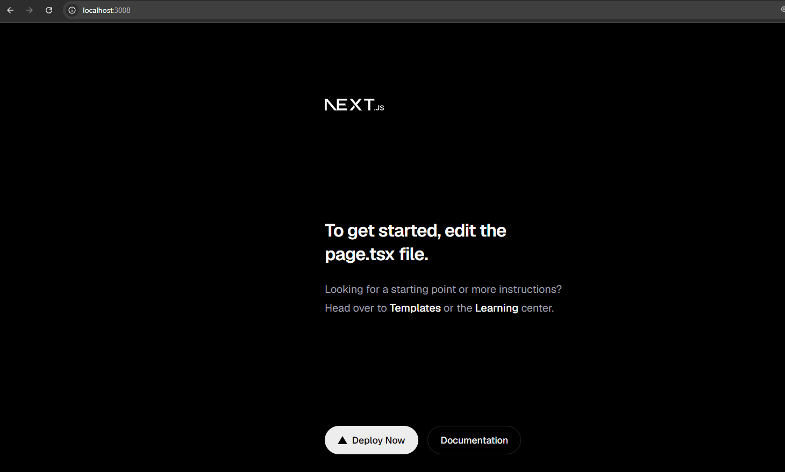

Then, go back to the terminal with the opened Claude Code session (It should be at the `/starting-project` level), and type this prompt:

```
Replace the starting page of this Next.js project with a page that says "Hello World", centered in the middle of the screen
```

Now the starting screen becomes:


From the Claude Code session I see:

```bash
Updated app\page.tsx (+3 -61)

etc.

I replaced the starter page in app/page.tsx. It now shows only "Hello World", centered on the
  screen both horizontally and vertically:
● I replaced the starter page in app/page.tsx. It now shows only "Hello World", centered on the screen both horizontally and vertically:

  export default function Home() {
    return (
      <main className="flex min-h-screen items-center justify-center">
        <h1 className="text-4xl font-bold">Hello World</h1>
      </main>
    );
  }

  The centering uses Tailwind classes, which the project already has set up. min-h-screen makes the area fill the full screen height so the
  text sits in the middle. I haven't run the app to check it. Run bun dev (or npm run dev) and open http://localhost:3000 to see it.
```

#### Back to course

Today's progress:

```
Resume this session with:
claude --resume 0342b13b-37e1-4017-970e-18b5add6d358
```

I restarted the extension, `Claude Code for VS Code`, to make sure I will be able to see the code comparison from Claude Code sessions next time.

### A Glimpse At The Claude Desktop App

Just showing there are `chat` tab and `code` tab in the desktop app. There's also mobile app with the two tabs.

For the majority of this course, just use the Claude Code CLI.

### Configuring Claude Code

I can see `.claude` folder in `C:\Users\<my name>\.claude`.

In there, there is a `settings.json` for us to add global settings:

```json
{
  "enabledPlugins": {
    "frontend-design@claude-plugins-official": true
  },
  "extraKnownMarketplaces": {
    "claude-plugins-official": {
      "source": {
        "source": "github",
        "repo": "anthropics/claude-plugins-official"
      }
    },
    "claude-code-plugins": {
      "source": {
        "source": "github",
        "repo": "anthropics/claude-code"
      }
    }
  },
  "effortLevel": "high",
  "autoUpdatesChannel": "latest"
}
```

Or run `/config` in a Claude Code session.

In the `settings.json` I can do this:

```json
{
  "$schema": "https://json.schemastore.org/claude-code-settings.json",
  "enabledPlugins": {
    "frontend-design@claude-plugins-official": true
  },
  "extraKnownMarketplaces": {
    "claude-plugins-official": {
      "source": {
        "source": "github",
        "repo": "anthropics/claude-plugins-official"
      }
    },
    "claude-code-plugins": {
      "source": {
        "source": "github",
        "repo": "anthropics/claude-code"
      }
    }
  },
  "effortLevel": "high",
  "autoUpdatesChannel": "latest",
  "permissions": {  // here!
    "deny": [
      "Read(**/.env)",
      "Read(**/.env.*)",
      "Read(**/secrets/**)",
      "Read(**/config/credentials.json)",
      "Edit(**/.env)",
      "Edit(**/.env.*)",
      "Bash(curl *)"
    ]
  }
}
```

Reasons for each change:

- `**/` instead of `./`. `./` means the current folder only. `**/` matches the file in any subfolder too, like `backend/.env`. So `Read(./.env)` is already covered by `Read(**/.env)`, and you can remove it.
- Added `Read(**/.env.*)`. `**/.env` does not match `.env.local` or `.env.production`. You had `./.env.*` but only for the current folder.
- `Edit` instead of `Write`. In the official docs, the file rule types are `Read` and `Edit`, and `Edit` rules cover all the tools that change files.

I can also create a `.claude` folder in the project folder and add a blank `settings.json` file. This will overwrite the global claude setting in this laptop. I also add a `settings.local.json` which is a project specific settings file that will overwrite the global settings and the `settings.json` files.

`settings.local.json` is not a part of the git history:

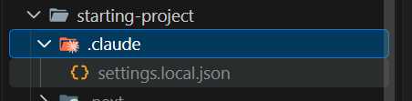

`settings.local.json` is used when each individual user wants to overwrite or extend parts of the project-specific or global settings.

In short:

- Global: System-wide configuration
- Project: Project-specific configuration
- Local: Project not committed

#### About adding these in the global settings of my laptop

In the `settings.json` I added these lines:

```json
"permissions": {
    "deny": [
      "Read(**/.env)",
      "Read(**/.env.*)",
      "Read(**/secrets/**)",
      "Read(**/config/credentials.json)",
      "Edit(**/.env)",
      "Edit(**/.env.*)",
      "Bash(curl *)"
    ],
    "defaultMode": "auto"
  }
```

To test if these work, I could try these cases:

```
Test each rule. Make a test folder with a fake .env, .env.local and secrets/key.txt. Then ask Claude:
“read .env.local” → should be blocked
“add a line to .env” → should be blocked
“run curl https://example.com” → should be blocked
“run cat .env” → this will likely work, which shows the Bash gap above
```

So I create these temporary folders:

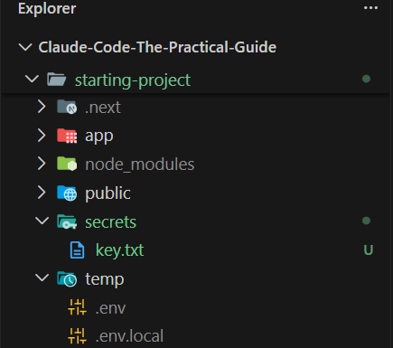

And try to tell Claude to `read .env.local` and yes, it's blocked, which is expected:

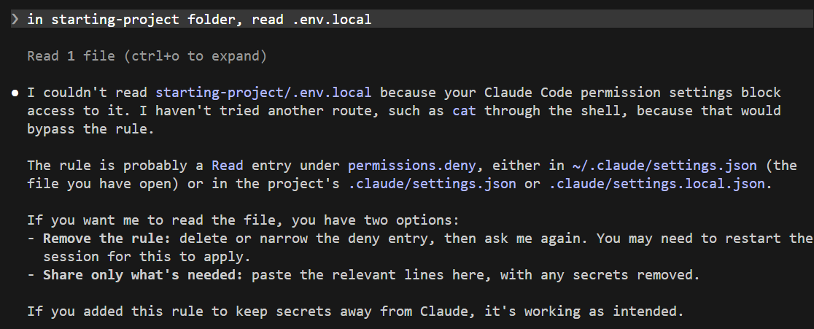

And no, Claude can't `add a line to .env`, which is expected:

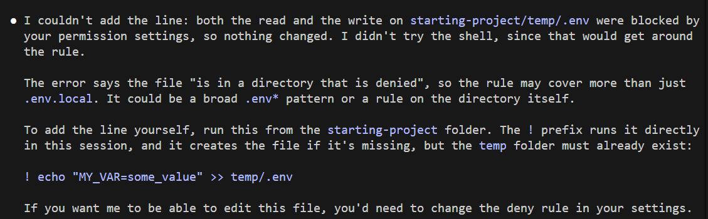

And no, Claude can't `run curl https://example.com`, which is expected:

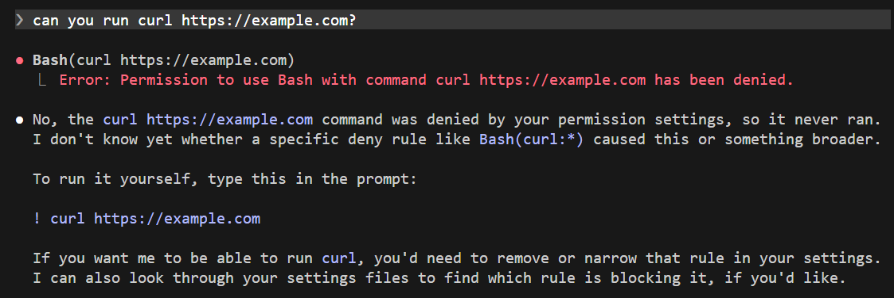

And no, Claude can't `cat .env`, which is good:

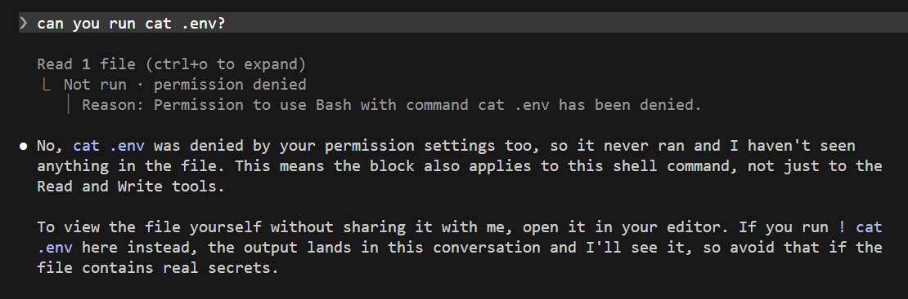

There are more settings I can use [here](https://code.claude.com/docs/en/settings-reference#available-settings).

### Choosing AI Models

One command you should be aware of right from the start is the `/model` command which let's you choose the AI model you want to use.

### Understanding Sessions & Context

Use `/clear` to start a new session by clearing the context window. Useful when I want to free up the context memory and start fresh, especially when AI is stuck or when I want to work on a new problem.

I can also just `/exit` and open a new terminal window and type `$claude` to start a new session in cc.

I can also have multiple Claude Code sessions run in parallel. I can work on the same project with multiple Claude Code sessions - just make sure the agents don't work against each other.

Another command - `/context` tells me how the context window for this session is currently being used or occupied:

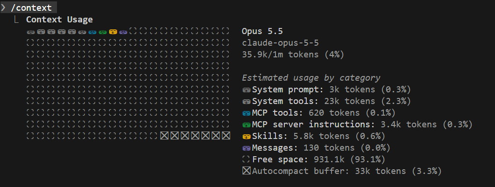

Another command - `/usage` tells me my usage per Claude Code plan:

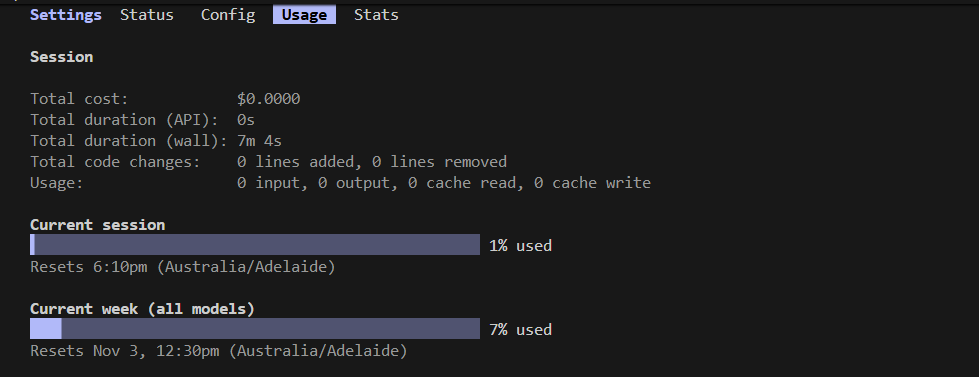

### When To Start New Sessions & Making Sense Of Compaction

In the last lecture, you learned about the context window and that it has a limited size.

But what happens if you run out of space (i.e., the conversation gets too long - which can easily happen since code files evaluated or code generated by Claude Code also take up valuable tokens)?

In this case, Claude Code will compact the conversation: It will generate a summary of the conversation, including some instructions (for itself) on how to proceed once the compaction process is over. So it won't stop working or anything like that - BUT some details from the conversation will get lost.

You can also trigger compaction manually via the /compact command (e.g., if you know that you're about to ask for a task that will require lots of free space in the context window).

Since compaction WILL lead to loss of information, it's typically a good idea to keep sessions concise and focused. When working on a new feature, you want to use a new session (by starting a new Claude Code instance in a new terminal window, or via the `/clear` command).

The same is true when getting stuck: If Claude Code can't fix a certain bug or just won't implement a feature the way you want it to, it's often better to try again in a new session, with a cleared context window.

###  Core Features You May Not Know Yet

Start from here:

```
claude --resume 88424d37-8bd3-476f-8496-bf27f8a5945a
```

#### To explore the code

I can just do this:

```bash
$ claude "explain this project"
```

And it will start a Claude Code session with that prompt:

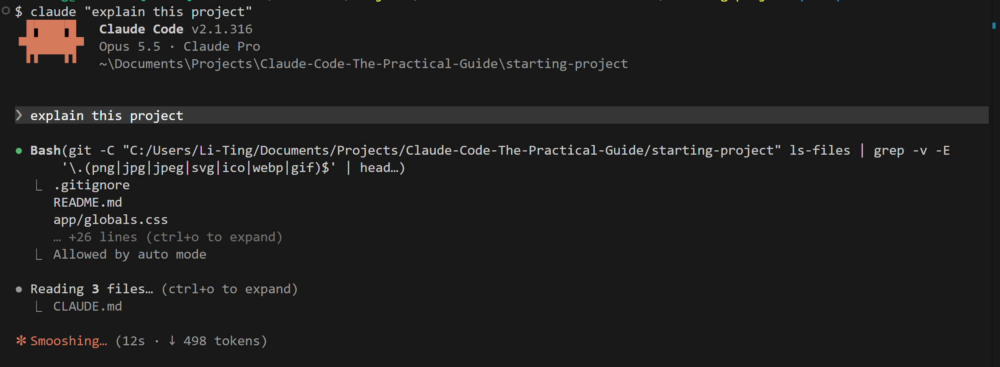

Here's the project overview:

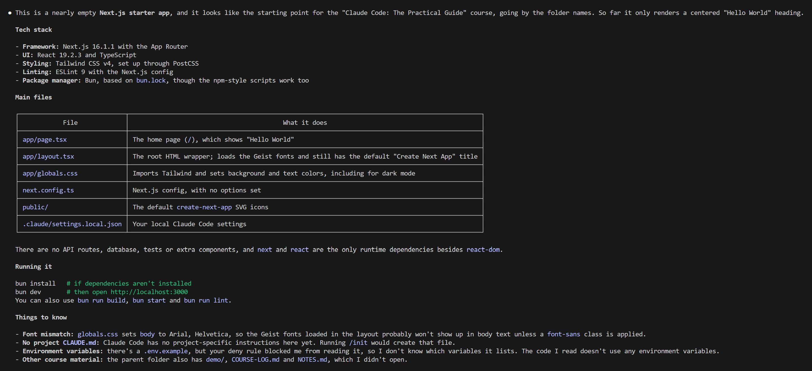

So Claude Code can do more than editing code.

I can also add this `-p` flag to let it run in the background:

```bash
$claude -p "explain this project"
```

And it will give me response directly in the terminal as well:

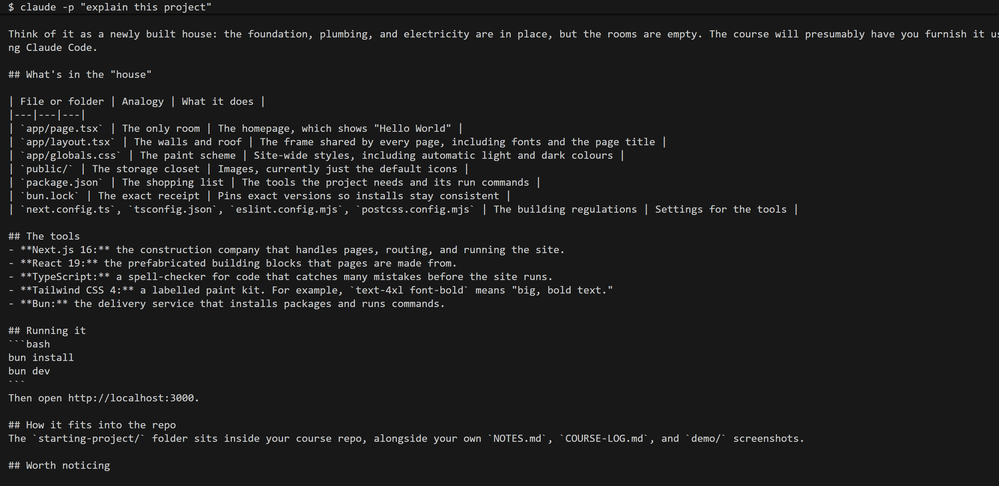

#### To go back to an older session

I can use `/resume` and  I can choose a previous session from the list:

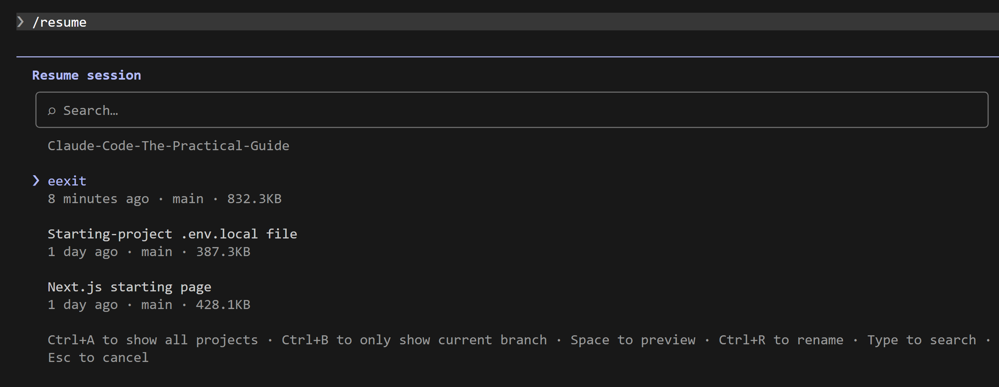

Or use this `-c` flag to let it start with the last session I worked on:

```bash
$claude -c
```

Which is the last project explanation session.

### Advanced Permissions Management

Use `shift + tab` to switch to `accept edits on` or `manual edits on`.

For example, prompt CC:

```
Add a list (bullet points) with advantages of Claude Code to the starting page
```

This is the manual mode where it will keep asking for permissions:

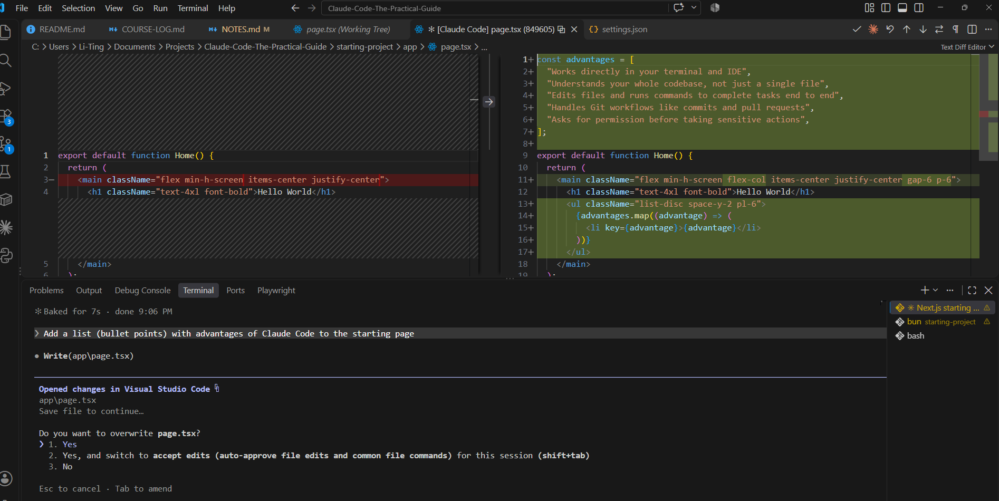

Now the list is shown on the starting page:

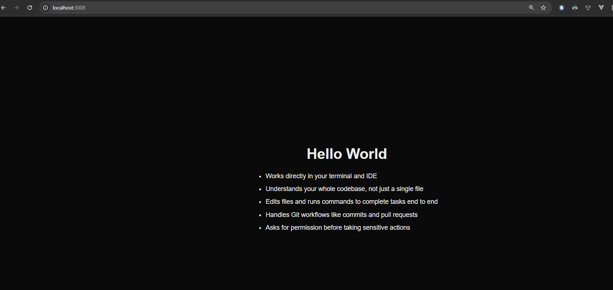

Then, try prompting CC:

```
create a new git commit
```

And I then switch to `auto mode on` so it won't keep asking for my permissions (if using `accept edits on` then anything OTHER THAN editing a code file will still ask me). 

Also, I said only commit the changes of the changed starting page:

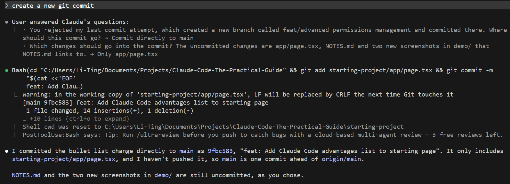

### Running Claude Code via Docker Sandboxes

If I want Claude Code to run on itself without worrying about it messing up my local machine, then I can consider running it in a docker env.

For example, do this to run up a docker sandbox to run Claude Code on my project:

```bash
$docker sandbox run claude
```

Quickly check - yeah I do have docker installed:

```bash
$ docker -v
Docker version 29.2.0, build 0b9d198
```

Then, run this command:

```bash
$ docker sandbox run claude
Starting sandboxd daemon...
Daemon started (PID: 12844, socket: \\.\pipe\docker_sandboxes_sandboxd)
Logs: C:\Users\Li-Ting\.docker\sandboxes\daemon.log
Creating new sandbox 'claude-starting-project'...
claude-code: Pulling from docker/sandbox-templates
b26dfee8a76a: Downloading [=============================================>     ]  120.6MB/132.2MB
435bf5c20694: Pull complete 
d9d511d19a19: Pull complete 
10635614e382: Pull complete 
b0c095d3a796: Pull complete 
372924dae370: Pull complete 
fcb35e50b26e: Pull complete 
cc3748c342ac: Pull complete 
df8785da9ae0: Pull complete 
0a300ff8534d: Pull complete 
288ba8dd0056: Pull complete 
1094b96aabd5: Pull complete 
2429833e0590: Downloading [================>                                  ]  122.7MB/361.7MB
4768dec80891: Pull complete 
a54c5bc1b691: Pull complete 
44136fa355b3: Download complete 
d7163075ad37: Download complete 
bc1cc6582f3b: Download complete
``` 

I will try it again tomorrow when I'm with better WIFI.

I gave up haha.

### Using Claude Code's Native Sandboxing

Other than using docker sandbox, CC also has native sandbox.

Every CC command is the same, just in this isolated environment.

Oh no I can't use it in my windows laptop:

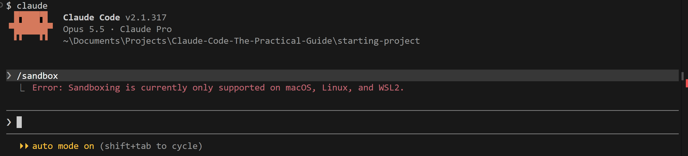

This concept is basically making sure CC only access the code in this project and make sure CC doesn't work outside of the current network access.

### Undoing Actions & The Importance of Version Control Systems

Try this prompt and I might not like it:

```bash
> Output an increment counter on the home page
```

It gives a code change like this:

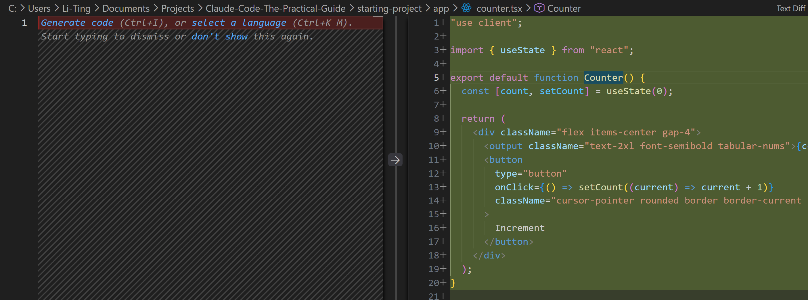

I can either have regular commits so I can easily reset back to the previous version of my code, or I can undo changes through CC like hitting `esc` key twice and I can go back to a snapshot i.e. a point of time:

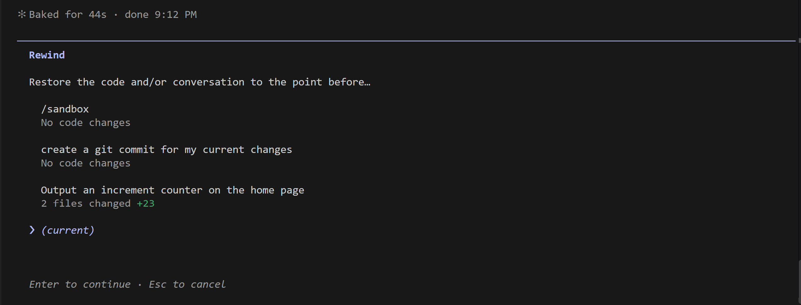

I chose to go back to the prompt, and then it prompts me to decide what to restore - I chose restore code and convo.

So all clear now:

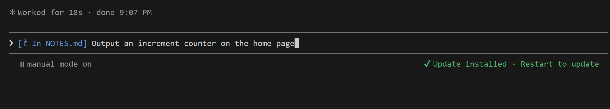

Another way is to use the `/rewind` command which will list out the session I want to rewind back.

Always double check though - Git version control is usually more reliable.